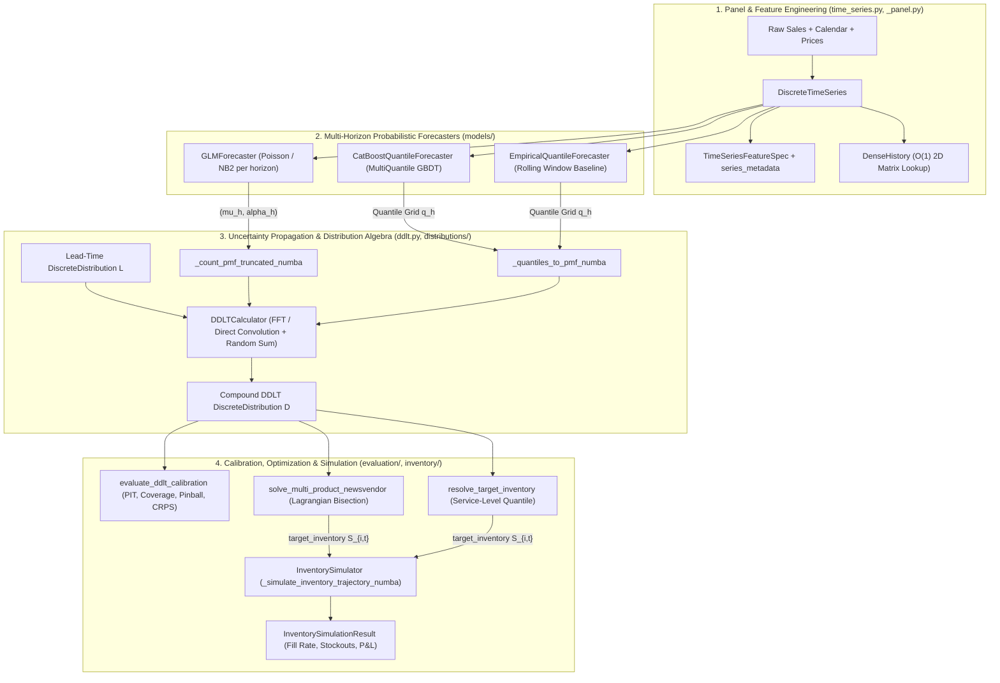

# Codebase & Algorithm Deep-Dive Guide (`probabilistic_modeling`)

This guide explains **what every piece of code in `probabilistic_modeling` does, where it is used, and why it is needed**, with a special mathematical and algorithmic deep dive into the Numba kernels in [`src/probabilistic_modeling/ddlt.py`](../src/probabilistic_modeling/ddlt.py).

For mathematical modeling background and CLI recipes, see also [`docs/DOCUMENTATION.md`](DOCUMENTATION.md).

---

## Table of Contents

1. [End-to-End Architecture & Data Flow](#1-end-to-end-architecture--data-flow)
2. [Deep Dive: `ddlt.py` — Numba Kernels, FFT Convolution & DDLT Propagation](#2-deep-dive-ddltpy--numba-kernels-fft-convolution--ddlt-propagation)
   - [2.1 Why DDLT Requires Full Distribution Algebra](#21-why-ddlt-requires-full-distribution-algebra)
   - [2.2 Support Truncation, Tail Lumping & `support_tol_for_service_level`](#22-support-truncation-tail-lumping--support_tol_for_service_level)
   - [2.3 Direct Convolution vs. Radix-2 FFT & The 2-in-1 Complex Packing Trick](#23-direct-convolution-vs-radix-2-fft--the-2-in-1-complex-packing-trick)
   - [2.4 Adaptive Quantile Lookup & Running-Max Monotone CDFs](#24-adaptive-quantile-lookup--running-max-monotone-cdfs)
   - [2.5 Prefix Convolution CDFs (`_build_prefix_cdfs_numba`)](#25-prefix-convolution-cdfs-_build_prefix_cdfs_numba)
   - [2.6 Log-Space Poisson & Negative Binomial PMF Generation (`_count_pmf_truncated_numba`)](#26-log-space-poisson--negative-binomial-pmf-generation-_count_pmf_truncated_numba)
   - [2.7 Random-Sum Mixture Accumulation (`_random_sum_aligned_numba`)](#27-random-sum-mixture-accumulation-_random_sum_aligned_numba)
   - [2.8 Quantile Spline Inversion (`_quantiles_to_pmf_numba`)](#28-quantile-spline-inversion-_quantiles_to_pmf_numba)
3. [Deep Dive: `_panel.py` — `DenseHistory` `O(1)` Panel Indexing](#3-deep-dive-_panelpy--densehistory-o1-panel-indexing)
4. [Complete Module & Function Reference (What / Where / Why)](#4-complete-module--function-reference-what--where--why)
   - [4.1 `distributions/discrete.py`](#41-distributionsdiscretepy)
   - [4.2 `distributions/quantile.py`](#42-distributionsquantilepy)
   - [4.3 `distributions/probability_utils.py`](#43-distributionsprobability_utilspy)
   - [4.4 `time_series.py`](#44-time_seriespy)
   - [4.5 `models/forecasters.py`](#45-modelsforecasterspy)
   - [4.6 `models/catboost_quantile.py`](#46-modelscatboost_quantilepy)
   - [4.7 `models/baseline.py`](#47-modelsbaselinepy)
   - [4.8 `evaluation/ddlt_calibration.py`](#48-evaluationddlt_calibrationpy)
   - [4.9 `inventory/newsvendor.py`](#49-inventorynewsvendorpy)
   - [4.10 `inventory/simulation.py`](#410-inventorysimulationpy)
   - [4.11 `__init__.py`, `logging_utils.py` & `scripts/`](#411-__init__py-logging_utilspy--scripts)

---

## 1. End-to-End Architecture & Data Flow

The library is organized into four clean layers that transform raw historical sales, lead-time logs, and unit economics into replenishment orders and simulated P&L:

---

## 2. Deep Dive: `ddlt.py` — Numba Kernels, FFT Convolution & DDLT Propagation

[`src/probabilistic_modeling/ddlt.py`](../src/probabilistic_modeling/ddlt.py) is the computational core of the library. Every function in it is designed so that propagating uncertainty across thousands of `(item, day)` rows runs in compiled Numba machine code without Python interpreter overhead or unnecessary heap allocations.

### 2.1 Why DDLT Requires Full Distribution Algebra

When an inventory system reviews stock every $R$ days (`cycle_time`) and supplier delivery takes a random integer lead time $L \in \{l_{\min}, \dots, l_{\max}\}$ days (`lead_time`), an order placed on day $t$ must cover cumulative demand over $N = L + R$ days:

$$D_t = \sum_{k=1}^{L + R} X_{t, k}$$

where $X_{t, k}$ is the random demand on day $t + k - 1$ (or $t + k$ if `pred_first_day=False`).

- **Why mean/variance formulas fail**: Classical textbook formulas ($\mu_D = \mathbb{E}[N]\mu_X$, $\sigma_D^2 = \mathbb{E}[N]\sigma_X^2 + \text{Var}(N)\mu_X^2$ with a Normal approximation) assume i.i.d., symmetric daily demands. Retail demand is **non-stationary** across horizons (e.g., weekend spikes, promotions), **discrete** ($0, 1, 2, \dots$), and **heavily right-skewed / zero-inflated**.
- **Exact discrete solution**:
  1. For each fixed realization $l$ of the total coverage window, the conditional distribution of $S_l = X_{t,1} + \dots + X_{t,l}$ is the **discrete convolution** $p_{X_{t,1}} * p_{X_{t,2}} * \dots * p_{X_{t,l}}$.
  2. Marginally over the random lead time $L$, the compound DDLT PMF is the **mixture of prefix convolutions**:
     $$\mathbb{P}(D_t = x) = \sum_{l = l_{\min}}^{l_{\max}} \mathbb{P}(L + R = l) \, \mathbb{P}(S_l = x)$$

---

### 2.2 Support Truncation, Tail Lumping & `support_tol_for_service_level`

Parametric distributions like Poisson and Negative Binomial have infinite support $\{0, 1, 2, \dots\}$. To represent them in finite memory as a [`DiscreteDistribution`](../src/probabilistic_modeling/distributions/discrete.py), we must choose a finite upper bound $K$ (`sup_max = int(ppf(1 - tol))`).

#### Why Tail Mass is *Lumped* Into Bin $K$ Instead of Renormalized
Suppose we truncate a distribution at $K$ with upper-tail probability $\varepsilon = \mathbb{P}(X > K) \le \text{tol}$:
- **If we renormalized** ($\tilde{p}(x) = p(x) / (1 - \varepsilon)$): Every interior probability $p(x)$ and every interior CDF value $F(x)$ for $x < K$ would be inflated by $1 / (1 - \varepsilon)$. Across $m$ convolutions, that inflation compounds by $(1 - \varepsilon)^{-m}$, distorting quantiles even in the body of the distribution.
- **Why [`_lump_upper_tail`](../src/probabilistic_modeling/distributions/discrete.py) lumps $\varepsilon$ into bin $K$**:
  By setting $\tilde{p}(K) = p(K) + \mathbb{P}(X > K)$ and leaving $\tilde{p}(x) = p(x)$ untouched for all $x < K$:
  1. The interior CDF $\tilde{F}(x) = F(x)$ is **exact** for every $x < K$.
  2. When $m$ distributions with upper-tail tolerances $\varepsilon_1, \dots, \varepsilon_m$ are convolved, the interior CDF of their sum is exact up to at least $1 - \sum_{i=1}^m \varepsilon_i$ (tracked via [`_combine_truncation`](../src/probabilistic_modeling/distributions/discrete.py) on `DiscreteDistribution._truncated_upper_tail`).
  3. If a caller later requests `dist.quantile(alpha)` with $1 - \alpha \le \varepsilon_{\text{total}}$ and the quantile lands on the final bin $K$, [`DiscreteDistribution.quantile`](../src/probabilistic_modeling/distributions/discrete.py) emits a [`TruncatedSupportWarning`](../src/probabilistic_modeling/distributions/discrete.py) alerting the user that the requested quantile may be clamped at the truncation boundary.

#### How `support_tol_for_service_level` Prevents Truncation Bias
When solving a high-margin newsvendor problem (where critical ratios $\frac{p - c + b}{p + b}$ can reach $0.995$) or requesting a high service level $\alpha$, [`support_tol_for_service_level(max_service_level, n_convolutions)`](../src/probabilistic_modeling/ddlt.py) computes:

$$\text{tol}_{\text{daily}} = \min\!\left(\text{base\_tol}, \; \frac{1 - \alpha_{\max}}{10 \cdot m}\right)$$

so that even after $m$ convolutions, total truncated upper-tail mass $\sum_{i=1}^m \text{tol}_{\text{daily}} = \frac{1 - \alpha_{\max}}{10}$ is an order of magnitude smaller than the tail probability $1 - \alpha_{\max}$ being queried.

---

### 2.3 Direct Convolution vs. Radix-2 FFT & The 2-in-1 Complex Packing Trick

When convolving two discrete PMFs $a$ (length $n$) and $b$ (length $m$), the output PMF $c = a * b$ has length $n + m - 1$:

$$c[k] = \sum_{i+j=k} a[i]\,b[j]$$

In [`_convolve_1d_numba`](../src/probabilistic_modeling/ddlt.py):
- **Small supports ($n \cdot m \le 4096$, `_FFT_COST_THRESHOLD`)**: Uses [`_convolve_direct_numba`](../src/probabilistic_modeling/ddlt.py), a cache-friendly $O(n \cdot m)$ double loop that skips zeros (`if ai == 0.0: continue`) and has zero FFT buffer allocation overhead.
- **Large supports ($n \cdot m > 4096$)**: Uses [`_convolve_fft_numba`](../src/probabilistic_modeling/ddlt.py), an $O(N \log N)$ Radix-2 Cooley-Tukey FFT where $N = 2^{\lceil \log_2(n + m - 1) \rceil}$.

#### Mathematical Derivation of the 2-in-1 Real-Signal Complex FFT Packing
Because both PMFs $a$ and $b$ are **real-valued** signals, running two separate complex forward FFTs (`FFT(a)` and `FFT(b)`) would waste half of the imaginary lanes. Instead, [`_convolve_fft_numba`](../src/probabilistic_modeling/ddlt.py) packs both real arrays into a **single** complex array of length $N$:

$$z[k] = a[k] + i \, b[k], \quad k = 0, \dots, N-1$$

By linearity of the Discrete Fourier Transform (DFT), the single forward FFT $Z = \text{DFT}(z)$ satisfies:

$$Z[k] = A[k] + i \, B[k]$$

Because $a[n]$ and $b[n]$ are real, their individual DFTs satisfy **Hermitian conjugate symmetry**:

$$A[-k \bmod N] = A^*[k], \qquad B[-k \bmod N] = B^*[k]$$

Taking the complex conjugate of $Z[-k \bmod N]$ gives:

$$Z^*[-k \bmod N] = A^*[-k \bmod N] - i \, B^*[-k \bmod N] = A[k] - i \, B[k]$$

Adding and subtracting $Z[k]$ and $Z^*[-k \bmod N]$ isolates $A[k]$ and $B[k]$ in $O(1)$ operations per frequency bin:

$$A[k] = \frac{Z[k] + Z^*[-k \bmod N]}{2}, \qquad B[k] = \frac{Z[k] - Z^*[-k \bmod N]}{2i}$$

Even better, to compute their pointwise product $C[k] = A[k] \cdot B[k]$ directly:

$$C[k] = A[k] B[k] = \frac{(Z[k] + Z^*[-k \bmod N])(Z[k] - Z^*[-k \bmod N])}{4i} = -\frac{i}{4}\left(Z[k]^2 - (Z^*[-k \bmod N])^2\right)$$

This requires only **1 forward FFT** + **1 inverse FFT** (`2` FFT passes total instead of `3`), cutting FFT convolution time by ~33%. Finally, small negative floating-point roundoff ($\sim -10^{-16}$) is clamped to $0.0$ and rescaled to preserve the exact total mass $\sum a \cdot \sum b$.

---

### 2.4 Adaptive Quantile Lookup & Running-Max Monotone CDFs

Given a discrete PMF on support $x_k = \text{min\_val} + k \cdot \text{bin\_size}$, the generalized inverse CDF (quantile) at level $\alpha \in [0, 1]$ is:

$$F^{-1}(\alpha) = \inf\{x_k : F(x_k) \ge \alpha\}$$

[`ddlt.py`](../src/probabilistic_modeling/ddlt.py) provides three specialized Numba quantile routines depending on the number of queries $m$ and support length $n$:

1. **Single query (`_pmf_quantile_scalar_numba`)**: Accumulates `cum += pmf[i]` in a scalar register and returns immediately as soon as `cum >= alpha - 1e-12`. Uses **$O(1)$ auxiliary memory** (never allocates a CDF array) and stops early in the lower/middle body of the distribution.
2. **Pre-built CDF binary search (`_cdf_quantile_scalar_numba`)**: Uses $O(\log n)$ binary search (`lo, hi`) over a precomputed CDF array.
3. **Adaptive multi-quantile dispatcher (`_pmf_quantiles_numba`)**:
   - When $m < 8$ or $n < 64$: calls `_pmf_quantile_scalar_numba` in a loop (zero heap allocation).
   - When $m \ge 8$ and $n \ge 64$: builds the CDF once via `_pmf_to_cdf_numba` in $O(n)$ and binary-searches each $\alpha_j$ in $O(\log n)$ (`O(n + m \log n)` total instead of `O(n \cdot m)`).

#### Subtle Numerical Detail in `_pmf_to_cdf_numba` and `_pmf_quantile_scalar_numba`
- **Floating-point sum overshoot**: In IEEE-754 arithmetic, summing $n$ positive floats whose true sum is $1.0$ can yield $1.0000000000000002$. `_pmf_to_cdf_numba` enforces strict monotonicity via `running_max` and clamps values above $1.0$ to $1.0$.
- **Under-normalized / defective PMFs**: Only if `running_max >= 1.0 - 1e-9` is `cdf[n - 1]` snapped to `1.0`. If a caller passes a custom PMF whose total mass is $< 1$ (e.g., $0.8$) and queries $\alpha = 0.9$, `_pmf_to_cdf_numba` and `_pmf_quantile_scalar_numba` do *not* artificially snap the final bin to $1.0$; Instead, they mirror `np.searchsorted(np.cumsum(pmf), alpha)` by returning the one-past-the-end support value `min_val + n * bin_size`.

---

### 2.5 Prefix Convolution CDFs (`_build_prefix_cdfs_numba`)

When a time series has historical observations mainly in a single parametric family (fallback distribution $X_{\text{hist}}$) and a lead-time distribution $L \in \{1, \dots, l_{\max}\}$, we often need the $k$-fold self-convolutions:

$$S_1 = X_{\text{hist}}, \quad S_2 = S_1 * X_{\text{hist}}, \quad \dots, \quad S_{l_{\max}} = S_{l_{\max}-1} * X_{\text{hist}}$$

[`_build_prefix_cdfs_numba`](../src/probabilistic_modeling/ddlt.py) computes all $l_{\max}$ prefix convolutions sequentially and converts each one to its monotone CDF in a `NumbaList`. This is used inside:
- [`_quantiles_to_pmf_numba`](../src/probabilistic_modeling/ddlt.py): when a lead time $l$ exceeds the number of forecasted quantile horizons $H$, the remaining $l - H$ days are filled from the precomputed fallback CDFs.
- [`_count_pmf_truncated_numba`](../src/probabilistic_modeling/ddlt.py): when `mu` is `NaN` or `<= 0` for a GLM horizon, falls back to `hist_cdf`.

---

### 2.6 Log-Space Poisson & Negative Binomial PMF Generation (`_count_pmf_truncated_numba`)

In [`GLMForecaster`](../src/probabilistic_modeling/models/forecasters.py), each row $(i, t)$ and horizon $h$ produces a predicted mean $\mu_{i,t,h} = \exp(x_{i,t}^\top \beta_h)$ and dispersion $\alpha_h$. Calling `scipy.stats.nbinom.pmf` or `scipy.stats.poisson.pmf` inside a loop over 30,000 items $\times$ 28 days $\times$ 7 horizons = **5.88 million calls** would spend minutes in Python/SciPy wrapper overhead.

[`_count_pmf_truncated_numba`](../src/probabilistic_modeling/ddlt.py) replaces SciPy completely inside Numba:
- **Poisson ($\alpha \text{ is NaN or } \le 0$)**:
  $$\log \mathbb{P}(X = k) = k \log \mu - \mu - \ln \Gamma(k + 1)$$
- **NB2 ($\alpha > 0$, with $r = 1/\alpha$ and $p = \frac{r}{r + \mu}$)**:
  $$\log \mathbb{P}(X = k) = \ln \Gamma(k + r) - \ln \Gamma(r) - \ln \Gamma(k + 1) + r \log p + k \log(1 - p)$$
- **Dynamic buffer doubling**: Evaluates $k = 0, 1, 2, \dots$ until `cum >= 1.0 - tol` (stopping only after $k \ge \mu$ so it never halts before the mode of the distribution), doubling the array capacity if needed, and lumps the remaining tail mass `1.0 - cum` into the final bin so the PMF sums to `1.0`.

---

### 2.7 Random-Sum Mixture Accumulation (`_random_sum_aligned_numba`)

Given daily demand distributions $X_1, X_2, \dots, X_{l_{\max}}$ (all with `bin_size == 1`) and a lead-time distribution $L$ (shifted by `cycle_time`), [`_random_sum_aligned_numba`](../src/probabilistic_modeling/ddlt.py) computes the compound DDLT distribution in a single sequential pass:

1. Maintains the running convolution `curr_pmf` and `curr_min` of $S_l = X_1 + \dots + X_l$ as $l$ steps from $1$ to $l_{\max}$.
2. Whenever $l$ matches the next positive-probability lead-time support point $l = \text{lt\_min} + idx \cdot \text{lt\_bin\_size}$ with weight $w = \mathbb{P}(L + R = l) > 0$:
   - Shifts `curr_pmf` into the global support grid `[global_min, global_max]` and accumulates `out[offset + k] += w * curr_pmf[k]`.
   - Tracks the weighted upper-tail truncation bound `weighted_trunc += w * curr_trunc`.

Because $S_l = S_{l-1} * X_l$ reuses $S_{l-1}$ at every step, computing the entire mixture across $l \in \{1, \dots, l_{\max}\}$ requires only $l_{\max} - 1$ convolutions in total (rather than $O(l_{\max}^2)$ convolutions).

---

### 2.8 Quantile Spline Inversion (`_quantiles_to_pmf_numba`)

When a quantile forecaster ([`CatBoostQuantileForecaster`](../src/probabilistic_modeling/models/forecasters.py) or [`EmpiricalQuantileForecaster`](../src/probabilistic_modeling/models/baseline.py)) predicts $K$ quantiles $\hat{q}(\tau_1), \dots, \hat{q}(\tau_K)$ for a discrete count demand variable, [`_quantiles_to_pmf_numba`](../src/probabilistic_modeling/ddlt.py) converts that continuous quantile curve into an integer PMF on $\{0, 1, \dots, M\}$:

1. **Non-crossing rearrangement**: Sorts and clips the quantile values so $0 \le \hat{q}_1 \le \dots \le \hat{q}_K$.
2. **Zero-inflation fast path**: If $\hat{q}_K \le 0$, returns a degenerate point mass of $1.0$ at $0$.
3. **Active horizon extraction**: Drops leading zeros so the piecewise-linear CDF interpolation is strictly increasing over the positive support.
4. **Integer grid CDF evaluation + differencing**: Evaluates $F(x)$ at each integer $x = 0, 1, \dots, M$ by linear interpolation between bracketing quantile knots $(\hat{q}_j, \tau_j)$, differences consecutive CDF values $p(x) = F(x) - F(x-1)$, and normalizes so $\sum_{x=0}^M p(x) = 1$.

---

## 3. Deep Dive: `_panel.py` — `DenseHistory` `O(1)` Panel Indexing

[`src/probabilistic_modeling/_panel.py`](../src/probabilistic_modeling/_panel.py) defines [`DenseHistory`](../src/probabilistic_modeling/_panel.py).

- **What problem it solves**: During multi-step DDLT propagation (when `pred_first_day=True`, row $(i, t)$ needs predictions from future rows $(i, t+1), \dots, (i, t+l-1)$) and rolling empirical quantile lookups ([`EmpiricalQuantileForecaster`](../src/probabilistic_modeling/models/baseline.py)), filtering a Pandas DataFrame via boolean masks `df[(df['item_id'] == i) & (df['day'] == t)]` inside a loop takes $O(\text{rows})$ per lookup ($O(\text{rows}^2)$ total).
- **How `DenseHistory` works**:
  1. [`DenseHistory.from_frame`](../src/probabilistic_modeling/_panel.py) maps each unique series key to a dense row index $s \in \{0, \dots, S-1\}$ and each period to an integer column offset $d = \text{day} - \text{min\_day} \in \{0, \dots, T-1\}$.
  2. Allocates a contiguous 2D `float64` matrix `values[s, d]` (filled with `NaN` where unobserved) and a boolean mask `valid[s, d]`.
  3. [`DenseHistory.locate`](../src/probabilistic_modeling/_panel.py) converts any query DataFrame into `(series_idx, day_idx)` integer arrays so downstream Numba/NumPy loops can slice `values[s, d_start:d_end]` in **$O(1)$ time**.

---

## 4. Complete Module & Function Reference (What / Where / Why)

### 4.1 [`distributions/discrete.py`](../src/probabilistic_modeling/distributions/discrete.py)

| Symbol | What It Does | Where It Is Used | Why It Is Needed |
| :--- | :--- | :--- | :--- |
| [`TruncatedSupportWarning`](../src/probabilistic_modeling/distributions/discrete.py) | `UserWarning` subclass emitted when `quantile(alpha)` lands on a truncated upper-tail bin. | Emitted in `DiscreteDistribution.quantile`; exported at package root. | Warns users when high service-level quantiles (e.g. `0.999`) are clamped by finite support truncation. |
| [`_combine_truncation(a, b)`](../src/probabilistic_modeling/distributions/discrete.py) | Returns `min(1.0, a + b)` for upper-tail truncation bounds. | `DiscreteDistribution.__add__` and `random_sum`. | By union bound, convolving two distributions with tail bounds $\varepsilon_a, \varepsilon_b$ has tail bound at most $\varepsilon_a + \varepsilon_b$. |
| [`_lump_upper_tail(pmf, tail_mass)`](../src/probabilistic_modeling/distributions/discrete.py) | Adds truncated upper-tail mass `1 - sum(pmf)` into `pmf[-1]` instead of renormalizing. | `DiscreteDistribution.from_data` and `from_glm`. | Keeps interior CDF values $F(x)$ for $x < \max$ exact rather than inflating every bin by $1/(1-\varepsilon)$. |
| [`PredictiveDistribution`](../src/probabilistic_modeling/distributions/discrete.py) | Abstract base class defining `mean`, `variance`, `std`, `median`, `quantile`, `sample`, `crps`. | Subclassed by `DiscreteDistribution` and `ContinuousQuantileDistribution`. | Provides a polymorphic interface across discrete PMF and continuous quantile representations. |
| [`compute_best_fit_distribution(data)`](../src/probabilistic_modeling/distributions/discrete.py) | Fits `nbinom`, `binom`, `poisson`, `geom`, `uniform` via method of moments and selects lowest discrete RMSE. | `DiscreteTimeSeries._fit_distributions` and `DiscreteDistribution.from_data(method="best_fit")`. | Automatic stationary fallback distribution for long lead times or missing forecast horizons. |
| [`DiscreteDistribution`](../src/probabilistic_modeling/distributions/discrete.py) | Immutable-style 1D discrete probability distribution over `min + k * bin_size`. Supports `+` (FFT/direct convolution), `@` (mixture), `random_sum`, `quantile`, `crps`, `sample`, `merge_bins`, `split_bins`. | Core distribution type across `ddlt.py`, `time_series.py`, `forecasters.py`, `newsvendor.py`, `simulation.py`, `ddlt_calibration.py`. | Unifies empirical histograms, parametric GLM distributions, quantile-derived PMFs, and compound DDLT distributions under one algebraic type. |

---

### 4.2 [`distributions/quantile.py`](../src/probabilistic_modeling/distributions/quantile.py)

| Symbol | What It Does | Where It Is Used | Why It Is Needed |
| :--- | :--- | :--- | :--- |
| [`DEFAULT_QUANTILES`](../src/probabilistic_modeling/distributions/quantile.py) | 15-point quantile grid `(0.01, 0.05, 0.10, ..., 0.95, 0.99)`. | Default grid for `CatBoostQuantileForecaster` and `EmpiricalQuantileForecaster`. | Captures both lower/upper tails and body resolution for spline inversion into discrete PMFs. |
| [`validate_quantile_levels(quantiles)`](../src/probabilistic_modeling/distributions/quantile.py) | Validates that quantile levels are 1D, strictly increasing, and in `(0, 1)`. | `CatBoostQuantileForecaster`, `EmpiricalQuantileForecaster`, `ContinuousQuantileDistribution`, `evaluate_quantile_forecasts`. | Prevents invalid probability levels or unsorted knots before training or spline interpolation. |
| [`rearrange_quantiles(q_preds, clip_Zero=True)`](../src/probabilistic_modeling/distributions/quantile.py) | Sorts predicted quantiles along the last axis (Chernozhukov et al. 2010 rearrangement) and clips at `0`. | `predict_catboost_quantile`, `ContinuousQuantileDistribution`, `quantiles_to_pmf`. | Multi-quantile regression trees do not enforce $\hat{q}(\tau_1) \le \hat{q}(\tau_2)$ by architecture; sorting restores monotonicity and weakly reduces pinball loss. |
| [`quantiles_to_pmf` / `quantiles_to_distribution`](../src/probabilistic_modeling/distributions/quantile.py) | Converts predicted quantile vectors into `DiscreteDistribution` objects via `_quantiles_to_pmf_numba`. | `ContinuousQuantileDistribution.to_discrete`, `DDLTCalculator`. | Bridges non-parametric quantile forecasts with discrete convolution algebra (`+`, `random_sum`). |
| [`quantiles_to_mean(levels, q_preds, tol)`](../src/probabilistic_modeling/distributions/quantile.py) | Computes expected value $\mathbb{E}[X]$ of the discrete distribution implied by each row's quantiles in parallel (`_batch_quantiles_to_mean_numba`). | `CatBoostQuantileForecaster.predict`, `EmpiricalQuantileForecaster.predict`. | Produces `<target>_mu` point forecasts directly from quantile grids without materializing Python `DiscreteDistribution` objects. |
| [`pinball_loss(y_true, q_pred, alpha)`](../src/probabilistic_modeling/distributions/quantile.py) | Asymmetric quantile check loss $\rho_\alpha(y - \hat{q})$. | `evaluate_quantile_forecasts`, `evaluate_ddlt_calibration`. | Proper scoring rule for evaluating calibration and sharpness at a specific quantile level $\alpha$. |
| [`quantile_crps(y_true, q_preds, quantiles)`](../src/probabilistic_modeling/distributions/quantile.py) | Approximates CRPS from a finite quantile grid using trapezoidal integration + tail triangles: $\text{CRPS}(F, y) = 2 \int_0^1 \rho_\alpha(y - F^{-1}(\alpha))\,d\alpha$. | `evaluate_quantile_forecasts`, `ContinuousQuantileDistribution.crps`. | Evaluates overall distributional accuracy of quantile forecasts without converting to a discrete PMF first. |
| [`ContinuousQuantileDistribution`](../src/probabilistic_modeling/distributions/quantile.py) | Piecewise-linear continuous distribution backed by `(quantiles, values)` with `.to_discrete()`. | Exported at package root; `tests/test_catboost_quantile.py`. | Lightweight wrapper for inspecting, sampling, or converting single quantile predictions. |

---

### 4.3 [`distributions/probability_utils.py`](../src/probabilistic_modeling/distributions/probability_utils.py)

| Symbol | What It Does | Where It Is Used | Why It Is Needed |
| :--- | :--- | :--- | :--- |
| [`rmse_discrete(data, distr_name, params)`](../src/probabilistic_modeling/distributions/probability_utils.py) | Computes RMSE between empirical PMF and a SciPy discrete distribution (`nbinom`, `binom`, `poisson`, `geom`, `uniform`). | `compute_best_fit_distribution` in `distributions/discrete.py`. | Selects the best parametric family for each time series. |
| [`fit_nbinom`, `fit_binom`, `fit_poisson`, `fit_geom`, `fit_uniform`](../src/probabilistic_modeling/distributions/probability_utils.py) | Closed-form Method-of-Moments parameter estimators from sample mean $\mu$ and variance $\sigma^2$. | `compute_best_fit_distribution` and `DiscreteDistribution.from_data`. | $O(N)$ closed-form fitting across thousands of series without slow iterative numerical MLE. |
| [`plot_distr_fit(data, distr_dict)`](../src/probabilistic_modeling/distributions/probability_utils.py) | Plots empirical PMF bars against candidate parametric PMF curves. | Interactive exploratory notebooks. | Visual diagnostic for comparing parametric fits on demand or lead-time data. |

---

### 4.4 [`time_series.py`](../src/probabilistic_modeling/time_series.py)

| Symbol | What It Does | Where It Is Used | Why It Is Needed |
| :--- | :--- | :--- | :--- |
| [`_parse_serialized_dict(val)`](../src/probabilistic_modeling/time_series.py) | Parses a `dict` serialized as JSON or Python literal string (`ast.literal_eval`). | `load_glm_model_data`, `GLMModel.from_dataframe`. | Pandas `.to_csv()` serializes dictionary cells using single-quoted Python `repr()` rather than strict JSON. |
| [`CalendarFeatureSpec` & `ExternalFeatureSpec`](../src/probabilistic_modeling/time_series.py) | Dataclasses recording arguments to `add_calendar_features` and `add_feature`. | Stored inside `TimeSeriesFeatureSpec`. | Allows replaying calendar and external covariate joins identically on new inference data. |
| [`TimeSeriesFeatureSpec`](../src/probabilistic_modeling/time_series.py) | Serializable feature engineering specification (`to_dict`, `from_dict`, `save`, `load`, `get_features_for_horizon`, `transform`). | Bound to `DiscreteTimeSeries.feature_spec` and `ProbabilisticForecaster.feature_spec_`. | Enables `forecaster.predict_from_raw(new_sales_df)` after loading a saved model without rebuilding the training dataset. |
| [`DiscreteTimeSeries`](../src/probabilistic_modeling/time_series.py) | Balanced panel builder with leak-free lags, 1-step-shifted rolling windows, boundary-masked multi-horizon targets, pre-launch zero trimming, and negative-lag future covariates. | Primary training/backtesting data pipeline (`scripts/run_m5_pipeline.py`). | Guarantees zero look-ahead leakage between training and test periods and provides a unified schema for all forecasters. |
| [`compute_lead_time_demand(...)`](../src/probabilistic_modeling/time_series.py) | Functional dispatcher routing DDLT requests to `ProbabilisticForecaster.compute_ddlt`. | Top-level package export, scripts, and tests. | Single function signature supporting `GLMForecaster`, `CatBoostQuantileForecaster`, and `EmpiricalQuantileForecaster`. |
| [`compute_distribution_dict(df, value, keys, method)`](../src/probabilistic_modeling/time_series.py) | Groups `df` by `keys` and fits a `DiscreteDistribution` per group on `df[value]`. | `scripts/run_m5_pipeline.py` (fitting store lead-time distributions). | Converts raw historical shipment logs into a dictionary of `DiscreteDistribution` objects keyed by `store_id`. |

---

### 4.5 [`models/forecasters.py`](../src/probabilistic_modeling/models/forecasters.py)

| Symbol | What It Does | Where It Is Used | Why It Is Needed |
| :--- | :--- | :--- | :--- |
| [`compute_forecasting_metrics(pred_df, target_cols, pred_columns)`](../src/probabilistic_modeling/models/forecasters.py) | Computes cumulative `actual`, `pred`, `under_diff`, `over_diff`, `abs_diff` across non-missing horizons. | Called at the end of `.predict()` in all forecasters. | Masks out `NaN` horizons near the end of the panel so `actual` and `pred` always sum over the exact same realized days. |
| [`evaluate_quantile_forecasts(...)`](../src/probabilistic_modeling/models/forecasters.py) | Computes per-horizon, per-quantile `pinball_loss`, empirical `coverage`, and `crps`. | `scripts/run_m5_pipeline.py`, `DiscreteTimeSeries.evaluate_quantile_forecasts`. | Quantifies probabilistic calibration and sharpness at the individual daily horizon level. |
| [`train_single_glm(...)`](../src/probabilistic_modeling/models/forecasters.py) | Fits a single Statsmodels Poisson or Negative Binomial GLM (`fit` or `fit_regularized`) and pops `"alpha"` out of `"coefficients"`. | `GLMForecaster.fit`, `time_series.train_glm`. | Isolates the NB2 dispersion parameter $\alpha$ from regression weights $\beta$ for clean matrix scoring. |
| [`GLMModel`](../src/probabilistic_modeling/models/forecasters.py) | Serializable container for grouped multi-horizon GLMs (`to_dataframe`, `from_dataframe`, `coefficients_table`, `save`, `load`). | `GLMForecaster.model`. | Gives GLM models the same JSON persistence and inspection ergonomics as `CatBoostQuantileModel`. |
| [`ProbabilisticForecaster`](../src/probabilistic_modeling/models/forecasters.py) | Abstract base class managing training context (`feature_spec_`, `series_metadata_`), `_resolve_inference_inputs`, `transform`, `predict_from_raw`, and persistence. | Base class for `GLMForecaster`, `CatBoostQuantileForecaster`, and `EmpiricalQuantileForecaster`. | Eliminates code duplication across forecasters and enables universal `load_forecaster(dir)`. |
| [`GLMForecaster`](../src/probabilistic_modeling/models/forecasters.py) | Grouped Poisson/NB2 multi-horizon forecaster (`fit`, `predict`, `compute_ddlt`, `save`, `load`). | `scripts/run_m5_pipeline.py`, `DiscreteTimeSeries.train_glm`. | Parametric count-distribution baseline with automatic per-series overdispersion routing. |
| [`CatBoostQuantileForecaster`](../src/probabilistic_modeling/models/forecasters.py) | Multi-horizon CatBoost `MultiQuantile` forecaster with leak-free temporal validation split (`fit`, `predict`, `compute_ddlt`, `save`, `load`). | `scripts/run_m5_pipeline.py`, `DiscreteTimeSeries.train_catboost`. | High-accuracy non-parametric gradient-boosted quantile forecaster for large retail panels. |
| [`load_forecaster(out_dir)`](../src/probabilistic_modeling/models/forecasters.py) | Inspects `forecaster_meta.json` (or model metadata files) and loads the matching `ProbabilisticForecaster` subclass. | Top-level package export, `scripts/run_m5_pipeline.py`. | Lets downstream scoring scripts load any saved model directory without hardcoding the model type. |

---

### 4.6 [`models/catboost_quantile.py`](../src/probabilistic_modeling/models/catboost_quantile.py)

| Symbol | What It Does | Where It Is Used | Why It Is Needed |
| :--- | :--- | :--- | :--- |
| [`multiquantile_loss(quantiles)`](../src/probabilistic_modeling/models/catboost_quantile.py) | Formats `"MultiQuantile:alpha=0.01,0.05,..."` string for CatBoost. | `train_catboost_quantile`. | Trains a single shared tree ensemble predicting all $K$ quantiles jointly (10x faster than training $K$ separate models). |
| [`prepare_features(df, feature_cols, cat_feature_cols)`](../src/probabilistic_modeling/models/catboost_quantile.py) | Casts categorical columns to string (replacing `NaN` with `"unknown"`), guaranteeing CatBoost `Pool` compatibility. | `train_catboost_quantile`, `predict_catboost_quantile`. | CatBoost raises a runtime error if a categorical feature contains `NaN` floats or mismatched category dtypes at inference time. |
| [`train_catboost_quantile` & `predict_catboost_quantile`](../src/probabilistic_modeling/models/catboost_quantile.py) | Fits a single-horizon `CatBoostRegressor` with early stopping and predicts rearranged, non-negative quantiles. | `CatBoostQuantileForecaster.fit` and `.predict`. | Encapsulates CatBoost `Pool` construction, hyperparameter defaults, and post-prediction quantile rearrangement. |
| [`CatBoostQuantileModel`](../src/probabilistic_modeling/models/catboost_quantile.py) | Container holding `(group, horizon)` CatBoost models, feature lists, `feature_importance()`, and `.cbm` + JSON persistence. | `CatBoostQuantileForecaster.model`. | Manages multi-file `.cbm` binary serialization alongside `catboost_meta.json`. |

---

### 4.7 [`models/baseline.py`](../src/probabilistic_modeling/models/baseline.py)

| Symbol | What It Does | Where It Is Used | Why It Is Needed |
| :--- | :--- | :--- | :--- |
| [`EmpiricalQuantileForecaster`](../src/probabilistic_modeling/models/baseline.py) | Zero-training rolling empirical quantile forecaster over the last $W$ historical observations per series (`fit`, `update_history`, `predict`, `compute_ddlt`, `save`, `load`). | `scripts/run_m5_pipeline.py --model-type empirical`, benchmarks. | Provides a fast, dependency-free non-parametric benchmark that plugs into the exact same DDLT and inventory simulation pipeline as CatBoost and GLM. |

---

### 4.8 [`evaluation/ddlt_calibration.py`](../src/probabilistic_modeling/evaluation/ddlt_calibration.py)

| Symbol | What It Does | Where It Is Used | Why It Is Needed |
| :--- | :--- | :--- | :--- |
| [`_pit_cdf(pmf, mn, bs, y)`](../src/probabilistic_modeling/evaluation/ddlt_calibration.py) | Computes $(F(y^-), F(y))$ for realized integer demand $y$. | `_ddlt_calibration_kernel`. | Needed for the non-randomized discrete PIT overlap $[F(y^-), F(y)] \cap [0, u]$. |
| [`_ddlt_calibration_kernel(...)`](../src/probabilistic_modeling/evaluation/ddlt_calibration.py) | Numba kernel computing expected CRPS, non-randomized PIT histogram, empirical coverage, pinball loss, and bias across stochastic lead-time realizations. | `evaluate_ddlt_calibration`. | Evaluates compound DDLT distributions directly against realized multi-day demand trajectories $Y_{i,t}(l) = \sum_{k=0}^{l-1} y_{i, t+k}$. |
| [`evaluate_ddlt_calibration(...)`](../src/probabilistic_modeling/evaluation/ddlt_calibration.py) | High-level entry point returning [`DDLTCalibrationResult`](../src/probabilistic_modeling/evaluation/ddlt_calibration.py) (`summary_df`, `coverage_df`, `pit_df`, `group_summary_df`, `row_metrics_df`). | Stage 4 of `scripts/run_m5_pipeline.py`, `tests/test_ddlt_calibration.py`. | Verifies whether the *convolved* DDLT distribution (which drives safety stock) is actually well-calibrated over the lead time. |

---

### 4.9 [`inventory/newsvendor.py`](../src/probabilistic_modeling/inventory/newsvendor.py)

| Symbol | What It Does | Where It Is Used | Why It Is Needed |
| :--- | :--- | :--- | :--- |
| [`solve_multi_product_newsvendor(...)`](../src/probabilistic_modeling/inventory/newsvendor.py) | Solves the budget-constrained multi-product newsvendor problem for a single group/day via Lagrangian bisection on the shadow price of capital $\theta \ge 0$. | `_solve_multi_product_newsvendor`, unit tests. | Allocates a finite purchasing budget $B$ across items by lowering each item's effective critical ratio $\frac{p_i - (1 + \theta)c_i + b_i}{p_i + b_i}$ until $\sum_i c_i q_i(\theta) \le B$. |
| [`_solve_multi_product_newsvendor(...)`](../src/probabilistic_modeling/inventory/newsvendor.py) | Applies `solve_multi_product_newsvendor` across groups (e.g., per `(store_id, day)`) and attaches `target_inventory`. | `resolve_target_inventory` in `inventory/simulation.py` when `policy="newsvendor"`. | Enforces per-store, per-day replenishment budgets across multi-day backtest panels. |

---

### 4.10 [`inventory/simulation.py`](../src/probabilistic_modeling/inventory/simulation.py)

| Symbol | What It Does | Where It Is Used | Why It Is Needed |
| :--- | :--- | :--- | :--- |
| [`_sample_lead_times_numba`](../src/probabilistic_modeling/inventory/simulation.py) | Maps a `(n_items, n_days)` matrix of uniform random numbers into integer lead times via `_pmf_quantile_scalar_numba`. | `InventorySimulator.run`. | Zero-allocation inverse-CDF sampling of stochastic lead times across all items and days. |
| [`_simulate_inventory_trajectory_numba`](../src/probabilistic_modeling/inventory/simulation.py) | Parallel Numba kernel simulating daily order-up-to replenishment using a look-ahead arrival buffer `arrivals_buf[t + lt]`. | `InventorySimulator.run`. | Simulates thousands of items across multi-week horizons in milliseconds while supporting order crossing, review cycles, and lost-sales vs. backorders. |
| [`_simulate_inventory_mc_numba`](../src/probabilistic_modeling/inventory/simulation.py) | Parallel Monte Carlo kernel simulating `n_sims` stochastic lead-time replications per item. | `InventorySimulator.run(n_mc_simulations=...)`. | Quantifies 5th–95th percentile uncertainty bands on fill rate and stockout frequency due to lead-time randomness. |
| [`resolve_target_inventory(...)`](../src/probabilistic_modeling/inventory/simulation.py) | Computes `target_inventory` from `demand_distribution` via `"quantile"`, `"newsvendor"`, `"precomputed"`, or `"auto"`. | `InventorySimulator.run`, `scripts/run_m5_pipeline.py`. | Decouples replenishment policy selection from the physical inventory trajectory simulator. |
| [`compute_simulation_kpis(...)`](../src/probabilistic_modeling/inventory/simulation.py) | Aggregates operational (`fill_rate`, `cycle_service_level`, `stockout_frequency`, `inventory_turnover`) and financial (`total_profit`, `profit_margin_pct`) KPIs. | `InventorySimulator.run`, `InventorySimulationResult.summarize`. | Produces standardized summary tables overall, per item, or per store/category. |
| [`InventorySimulator` & `simulate_inventory`](../src/probabilistic_modeling/inventory/simulation.py) | Object-oriented and functional entry points returning [`InventorySimulationResult`](../src/probabilistic_modeling/inventory/simulation.py). | Stage 6 of `scripts/run_m5_pipeline.py`, top-level package export. | End-to-end validation of how probabilistic forecasts translate into realized service levels and profit. |

---

### 4.11 `__init__.py`, `logging_utils.py` & `scripts/`

- [`src/probabilistic_modeling/__init__.py`](../src/probabilistic_modeling/__init__.py): Uses PEP 562 module-level `__getattr__` lazy imports (`_LAZY_EXPORTS`) so `import probabilistic_modeling` is instantaneous and only imports heavy dependencies (`catboost`, `statsmodels`) when a user actually accesses `CatBoostQuantileForecaster` or `GLMForecaster`.
- [`src/probabilistic_modeling/logging_utils.py`](../src/probabilistic_modeling/logging_utils.py): Defines [`setup_logging`](../src/probabilistic_modeling/logging_utils.py) for uniform timestamped console + file logging across library modules and CLI scripts.
- [`scripts/process_m5_dataset.py`](../scripts/process_m5_dataset.py): Downloads, MD5-verifies, unpivots, and partitions the M5 competition dataset into per-store Parquet files (`sales_data_<store_id>.parquet`, `calendar.parquet`, `price.parquet`, `lead_time.parquet`, `newsvendor.parquet`).
- [`scripts/run_m5_pipeline.py`](../scripts/run_m5_pipeline.py): 6-stage CLI orchestrator executing Feature Engineering $\to$ Training/Loading (`catboost`, `glm`, or `empirical`) $\to$ Multi-Horizon Evaluation $\to$ DDLT Propagation & Calibration $\to$ Target Inventory Optimization (`quantile` or `newsvendor`) $\to$ Multi-Period Inventory Simulation.
