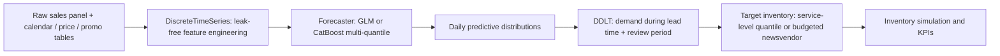
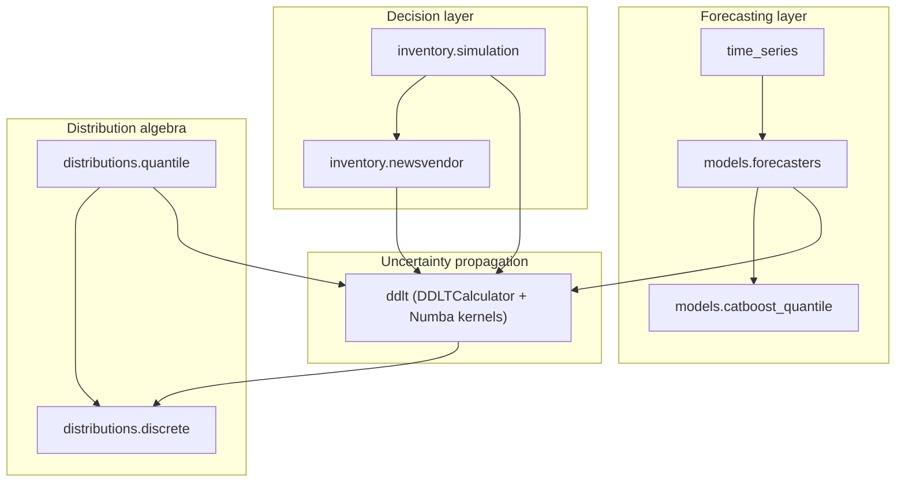

# Probabilistic Modeling — Architecture, Methods & Usage Guide

This document explains **what** the library does, **how** it is put together, and **how to use it** for your own forecasting and inventory problems. It focuses on concepts and workflows rather than API minutiae; see [`docs/CODEBASE_GUIDE.md`](CODEBASE_GUIDE.md) for a function-by-function codebase walkthrough (what each symbol does, where it is used, why it is needed, and the mathematical/algorithmic internals of `ddlt.py`), the docstrings in `src/probabilistic_modeling/` for full parameter references, and the slides in `docs/slides/` for the underlying theory.

---

## Contents

1. [Big Picture](#1-big-picture)
2. [Package Architecture](#2-package-architecture)
3. [Core Concepts & Data Contracts](#3-core-concepts--data-contracts)
4. [Models & Techniques](#4-models--techniques)
5. [Performance Engineering](#5-performance-engineering)
6. [Tutorials](#6-tutorials)
7. [Adapting the Library to Other Domains](#7-adapting-the-library-to-other-domains)
8. [Testing](#8-testing)
9. [Known Limitations & Roadmap](#9-known-limitations--roadmap)
10. [Glossary](#10-glossary)

---

## 1. Big Picture

Most forecasting projects stop at a point forecast. Inventory decisions, however, depend on the **full distribution of demand over the replenishment lead time** together with product economics and operational constraints. The library therefore models the whole decision chain:



Every stage has a clear input/output contract, so you can enter or leave the pipeline at any point — e.g. bring your own forecasts and only use the DDLT + inventory layers, or use only the distribution algebra.

---

## 2. Package Architecture

### 2.1 Repository layout

```text
.
├── src/probabilistic_modeling/      # the installable library
│   ├── __init__.py                  # lazy top-level re-exports
│   ├── distributions/
│   │   ├── discrete.py              # DiscreteDistribution, PredictiveDistribution ABC
│   │   ├── quantile.py              # quantile grid -> distribution, CRPS, pinball loss
│   │   └── probability_utils.py     # parametric fitting helpers (Poisson, NB, ...)
│   ├── ddlt.py                      # Numba kernels + DDLTCalculator
│   ├── time_series.py               # DiscreteTimeSeries + TimeSeriesFeatureSpec
│   ├── models/
│   │   ├── forecasters.py           # ProbabilisticForecaster, GLMForecaster, CatBoostQuantileForecaster
│   │   └── catboost_quantile.py     # CatBoost MultiQuantile training & persistence
│   ├── inventory/
│   │   ├── newsvendor.py            # budget-constrained multi-product newsvendor
│   │   └── simulation.py            # multi-period replenishment simulator + KPIs
│   └── logging_utils.py
├── scripts/                         # runnable end-to-end M5 example
│   ├── process_m5_dataset.py
│   └── run_m5_pipeline.py
├── tests/                           # pytest suite (+ benchmarks against a legacy implementation)
├── docs/
│   ├── DOCUMENTATION.md             # this file
│   └── slides/                      # LaTeX/Beamer presentation on the theory
└── pyproject.toml
```

### 2.2 Layering

The package is organised in layers; each layer only depends on the ones below it.



| Layer | Responsibility | Key objects |
|---|---|---|
| Distribution algebra | Represent, combine and score discrete demand distributions | `DiscreteDistribution`, `ContinuousQuantileDistribution`, `quantiles_to_distribution` |
| Uncertainty propagation | Turn per-day forecasts + stochastic lead time into lead-time demand | `DDLTCalculator`, `DiscreteDistribution.random_sum` |
| Forecasting | Feature engineering, model training, prediction, persistence | `DiscreteTimeSeries`, `TimeSeriesFeatureSpec`, `GLMForecaster`, `CatBoostQuantileForecaster`, `load_forecaster` |
| Decision | Turn lead-time demand into stock targets and evaluate them over time | `solve_multi_product_newsvendor`, `resolve_target_inventory`, `InventorySimulator` |

### 2.3 Import conventions

The most common objects are available directly from the top-level package; heavy dependencies (CatBoost, statsmodels) are only imported on first use, so `import probabilistic_modeling` stays fast.

| What you need | Import from |
|---|---|
| Everyday objects | `probabilistic_modeling` (e.g. `DiscreteDistribution`, `DiscreteTimeSeries`, `GLMForecaster`, `simulate_inventory`) |
| Distribution helpers | `probabilistic_modeling.distributions` |
| Forecasters & metrics | `probabilistic_modeling.models` |
| Inventory layer | `probabilistic_modeling.inventory` |
| Low-level Numba kernels | `probabilistic_modeling.ddlt` (private `_..._numba` functions; not a stable API) |

---

## 3. Core Concepts & Data Contracts

### 3.1 Panel data

All inputs are **long-format panels**: one row per *series* × *period*.

- **Series identifiers** (`ts_id_cols`) — e.g. `store_id`, `item_id`. Any number of columns.
- **Period column** (`period_col`) — an integer day index or a date.
- **Target column** (`var_col`) — non-negative integer demand.
- **External tables** — calendars, prices, promotions — are joined on the period column plus optional keys (e.g. price on `store_id`, `item_id`).

### 3.2 Horizons and target columns

Forecasts are made for `num_future_targets` horizons. The target for horizon *h* is stored as `target_t_plus_<h>`; on decision day *t*, `target_t_plus_0` is the realised demand of day *t* itself. Predictions add:

- `target_t_plus_<h>_mu` — predicted mean;
- `target_t_plus_<h>_q<τ>` — predicted quantile at level τ (quantile models);
- GLM parameters (mean and dispersion) for count models.

### 3.3 Train / test / production modes

`DiscreteTimeSeries` supports two modes via `num_test_days`:

| Mode | `num_test_days` | Use |
|---|---|---|
| Backtest | `> 0` | The last *N* periods are held out. Training rows whose future targets fall inside the test window are masked, so there is **no look-ahead leakage**. |
| Production | `0` | Train on the full history and forecast from the latest observed period. Future-known covariates (holidays, planned promotions, scheduled prices) are attached via **negative lags** (leads). |

### 3.4 Predictive distributions

Every forecast distribution implements the `PredictiveDistribution` interface: `mean`, `variance`, `std`, `quantile`, `cdf_at`, `crps`, `sample`. Two implementations exist:

- **`DiscreteDistribution`** — a PMF over an integer grid (`min`, `bin_size`, `pmf`). Supports convolution (`+`), i.i.d. random sums (`@`), non-identical random sums (`random_sum`), shifting, bin merging/splitting, and fitting from data or parametric families.
- **`ContinuousQuantileDistribution`** — a piecewise-linear quantile function built from a quantile grid; convertible to discrete via `to_discrete()`.

### 3.5 Forecaster bundles (train once, predict many times)

A fitted forecaster can be saved to a **self-contained directory bundle** that contains:

1. the model weights (GLM coefficients table or CatBoost `.cbm` files);
2. the **feature specification** (`TimeSeriesFeatureSpec`) — lags, rolling windows, calendar and external feature definitions, encodings;
3. **per-series metadata** learned at training time (overdispersion flags, fallback best-fit distributions).

`load_forecaster(path)` auto-detects the model type and returns a forecaster that can predict on new raw data **without the original training object**, because it can rebuild the exact same features itself (`transform` / `predict_from_raw`).

---

## 4. Models & Techniques

### 4.1 Feature engineering (`DiscreteTimeSeries`)

- Complete series × period grid with configurable fill value.
- Lag features, rolling means and (optionally) rolling standard deviations, computed **strictly from the past**.
- Log transformation of demand-derived features.
- Calendar features: weekend indicator or day-of-week encodings.
- External features with historical lags, future leads, rolling windows, and categorical handling (one-hot for GLMs, native categoricals for CatBoost).
- Optional down-sampling of zero-demand rows and trimming of leading zeros (products not yet launched).
- Optional fitting of historical best-fit distributions per series, used when lead time + review period extends beyond the forecast horizon.

### 4.2 Count-regression GLMs (`GLMForecaster`)

For each training group (e.g. store × category × overdispersion flag) and each horizon:

- **Poisson GLM** when the historical variance does not exceed the mean;
- **Negative-binomial GLM** when the series is overdispersed (dispersion α estimated separately).

Strengths: fast, interpretable coefficients, naturally produces discrete distributions. Weaknesses: limited non-linearity and interactions.

### 4.3 CatBoost multi-quantile regression (`CatBoostQuantileForecaster`)

- One gradient-boosted model per horizon trained with the **`MultiQuantile` loss** — the sum of pinball losses over the full quantile grid — so all quantiles come from a single model.
- Native categorical handling (item, department, category, weekday, event type).
- Temporal validation split for early stopping; optional rolling training window.
- Predicted quantile grids are post-processed into proper distributions (next section).

Strengths: captures non-linear effects and interactions, no distributional assumption. Weaknesses: heavier to train, requires quantile-to-distribution reconstruction.

### 4.4 From quantiles to a discrete distribution

Predicted quantiles are converted to a non-negative integer PMF in four steps:

1. **Monotone rearrangement** — sort the predicted quantiles to remove quantile crossing, and clip at zero.
2. **Interpolation** — linear between quantile knots.
3. **Tail extrapolation** — linear lower tail down to τ = 0; exponential upper tail through the last two knots up to 1 − tol.
4. **Discretisation** — P(D ≤ y) = P(Q(U) < y + 0.5).

### 4.5 Demand during lead time + review period (DDLT)

Replenishment orders placed today only arrive after a stochastic lead time *L*, and the next order opportunity is *R* days (review period) later. The stock must therefore cover

$$D^{L+R}_t = \sum_{j=0}^{L+R-1} D_{t+j}$$

Because the daily distributions differ across the horizon and *L* is random, this is a **mixture of convolutions**: for each possible lead time ℓ, convolve the first ℓ + R daily distributions, then weight by P(L = ℓ). When ℓ + R exceeds the forecast horizon, the historical best-fit distribution of the series fills the gap. `DDLTCalculator` performs this for both quantile-based and GLM forecasts and can return either the full distribution or directly a service-level target.

### 4.6 Choosing a target inventory

Two policies are supported (and a third option to bring your own):

| Policy | Rule | Needs |
|---|---|---|
| **Quantile** (`policy="quantile"`) | Target = τ-quantile of the DDLT distribution (e.g. τ = 0.95). | Only the DDLT distribution. |
| **Budgeted newsvendor** (`policy="newsvendor"`) | Each product gets an economically optimal critical fractile, adjusted by a shared budget shadow price. | Selling price, purchase cost, shortage penalty, budget. |
| **Precomputed** (`policy="precomputed"`) | Use an existing `target_inventory` column. | Your own targets. |

**Multi-product newsvendor under a budget.** With price *p*, cost *c* and shortage penalty *b*, the unconstrained critical fractile is (p − c + b)/(p + b). A shared budget *B* is enforced through a Lagrange multiplier *k* ≥ 0:

$$q_i(k) = F_i^{-1}\left(\operatorname{clip}\left(\frac{p_i - c_i(1+k) + b_i}{p_i + b_i}, 0, 1\right)\right), \qquad \sum_i c_i q_i(k) \le B$$

A binary search over *k* finds the smallest multiplier that satisfies the budget. Problems can be solved independently per group (e.g. per store and day).

### 4.7 Multi-period inventory simulation

The simulator replays the test period day by day for every item, using the forecast-driven targets and realised demand:


- **Order-up-to rule**: on review days, order max(0, target − inventory position), where inventory position = on-hand + in-transit − backlog.
- **Lead times**: sampled from the lead-time distribution (or fixed at its mean/median, or a constant).
- **Unmet demand**: lost (retail default) or backordered.
- **Initial stock**: the first day's target, zero, a constant, or a per-item array.
- **Monte Carlo**: optionally repeat the simulation over many lead-time draws to obtain KPI uncertainty bands (mean, std, 5th/95th percentiles).

**Outputs.** A daily trajectory per item (opening stock, arrivals, inventory position, order, lead time drawn, demand, sold, lost sales, closing stock, in-transit, plus revenue / purchase spend / holding cost / shortage cost / profit when economics are present) and KPI tables overall, per group and per item:

| KPI | Meaning |
|---|---|
| Fill rate | Units sold ÷ units demanded |
| Cycle service level | Share of item-days without a stockout |
| Stockout frequency | 1 − cycle service level |
| Average on-hand / closing / in-transit stock | Capital tied up in inventory |
| Inventory turnover | Units sold ÷ average stock |
| Revenue, purchase cost, holding cost, shortage cost, profit, margin | Economic outcome of the policy |

### 4.8 Forecast evaluation

- **Point accuracy**: WMAPE at store and category level.
- **Probabilistic accuracy**: pinball loss per quantile, empirical coverage per quantile level (calibration), and **CRPS** (for both quantile grids and discrete PMFs).
- **Decision quality**: the simulation KPIs above — the ultimate test of a probabilistic forecast.

### 4.9 DDLT calibration and the naive baseline

Daily metrics can look fine while the **decision distribution** is wrong. Inventory targets are quantiles of the DDLT distribution, so `evaluate_ddlt_calibration` (`probabilistic_modeling.evaluation`) checks the DDLT itself against realised demand over the replenishment window. Because the lead time of a hypothetical backtest order is unknown, every statistic is an exact expectation over the lead-time distribution.

| Metric | Calibrated value | How to read it |
|---|---|---|
| `pit_coverage` at τ (and `gap_pp`) | τ (0 pp) | Below τ → targets too low; above → too high. Discrete-correct, so it can be compared to τ directly |
| `coverage` at τ | ≥ τ | Raw achieved cycle service level P(Y ≤ q_τ); always somewhat above τ for discrete demand even when calibrated |
| PIT histogram (`density` by decile) | flat at 1.0 | U-shape → too narrow; hump → too wide; slope → biased |
| `dispersion_ratio` = E[(Y−μ)²] / E[σ²] | 1.0 | **> 1 means the DDLT is too narrow**, the typical symptom of ignoring day-to-day correlation |
| `bias_pct` | 0 | Mean over- or under-forecast of lead-time demand |
| `crps` | lower is better | Overall distribution quality; compare models |

`EmpiricalQuantileForecaster` (`models.baseline`) is a deliberately simple yardstick. It uses per-series empirical quantiles of the last *W* days (`trailing`) or of the same weekday (`seasonal`), with no covariates and no look-ahead. It produces the same columns as the CatBoost forecaster, so it flows through the same DDLT, policy, simulation and calibration code. A model is only worth its complexity if it beats this baseline on decision KPIs (fill rate for a given stock level, or profit).

Both are wired into the M5 script: `--evaluate-ddlt --baseline trailing` writes `ddlt_calibration_*.csv` and `decision_benchmark.csv`.

---

## 5. Performance Engineering

The numerically heavy parts are implemented as **Numba-compiled kernels** (`ddlt.py`, `inventory/simulation.py`), compiled on first use and cached on disk.

| Technique | Where | Effect |
|---|---|---|
| Fused random-sum kernel accumulating directly into one output vector | DDLT | No intermediate 2D matrices |
| Compiled Poisson / NB2 PMFs (log-space) feeding the random-sum kernel | GLM → DDLT | ~20× faster than per-day scipy objects |
| Tail trimming of negligible probability mass | Convolution | Keeps supports small |
| Adaptive convolution: direct for small inputs, radix-2 FFT for large ones | Convolution | 12×–49× speed-ups on 10k–25k-bin distributions |
| Optional `rocket-fft` integration | Convolution | Uses NumPy FFT inside Numba when installed |
| O(1)-memory quantile lookup directly on PMFs | Newsvendor, quantile targets | No CDF arrays allocated |
| Adaptive quantile search: early-exit scan for few queries, CDF + binary search for many | `quantile([...])`, `sample()` | Up to ~70× faster for thousands of queries; identical results |
| CDF prefixes up to the unconstrained answer + binary search in the shadow-price loop | Newsvendor | ~1.2–1.4× (the k = 0 scan dominates) |
| Parallel (`prange`) loops over items and Monte Carlo runs | Simulation, PMF reconstruction | Scales with CPU cores |

> First calls are slower because of JIT compilation; subsequent runs hit the on-disk cache.

### Very high service levels (99.99% and beyond)

Unbounded distributions are stored on a finite support that cuts off a small upper-tail mass `tol` (default 1e-4). The cut-off mass is lumped into the last bin, so the CDF is exact below it, but quantiles above `1 − tol` would be biased low. The library guards against this:

- `support_tol_for_service_level(sl, n_terms)` picks `tol = min(1e-4, (1 − sl) / (10 · n_terms))`;
- `DDLTCalculator` applies it automatically from the `service_level` column (target mode) or from `max_service_level=` (distribution mode, also accepted by `compute_lead_time_demand` and `compute_ddlt`);
- `DiscreteDistribution.from_parametric(..., max_service_level=0.9999)` does the same for single distributions;
- every distribution carries a `truncation_tol`, and `quantile()` emits a `TruncatedSupportWarning` when asked for a level above `1 − truncation_tol`.

---

## 6. Tutorials

The tutorials describe the workflow step by step; code is kept to short sketches.

### Tutorial 1 — Run the full M5 example

1. **Install** the package with the M5 extras: `pip install -e ".[m5,dev]"`.
2. **Prepare data**: `python scripts/process_m5_dataset.py --download` downloads the M5 archive, verifies its checksum, reshapes it to a long panel, joins calendar and prices, generates synthetic lead-time and economics tables, and writes store-partitioned Parquet files.
3. **Run the pipeline**: `python scripts/run_m5_pipeline.py --model glm` (or `--model catboost`). Per store it builds features, trains the model, predicts all test days, computes DDLT distributions, sets targets (newsvendor by default, or `--target-policy quantile --service-level 0.95`), and simulates the 28-day test period.
4. **Inspect outputs** in `data/output/`: predictions with quantiles and targets, WMAPE and quantile-calibration tables, saved model bundles, and simulation KPI tables.

### Tutorial 2 — Forecast your own sales data

1. Shape your data as a long panel (series ids, period, integer demand).
2. Create a `DiscreteTimeSeries`, choosing lags, rolling windows, the number of horizons, and the number of test days (0 for production).
3. Attach calendar features and any external tables (prices, promotions, weather). Use negative lags for covariates that are known in advance.
4. Pick a forecaster:
   - `GLMForecaster` for a fast, interpretable baseline;
   - `CatBoostQuantileForecaster` with a quantile grid for flexible, assumption-free distributions.
5. `fit` on the time series, then `predict` to obtain means and quantiles per horizon.
6. Evaluate with `compute_forecasting_metrics` (WMAPE) and `evaluate_quantile_forecasts` (pinball loss, coverage, CRPS).

```python
from probabilistic_modeling import DiscreteTimeSeries, CatBoostQuantileForecaster

ts = DiscreteTimeSeries(sales_df, ts_id_cols=["store_id", "item_id"], period_col="day",
                        var_col="demand", num_future_targets=7, num_test_days=28)
ts.add_calendar_features(calendar_df, "wday")
forecaster = CatBoostQuantileForecaster(quantiles=(0.1, 0.5, 0.9, 0.95))
forecaster.fit(ts)
predictions = forecaster.predict(ts)
```

### Tutorial 3 — Save a model and reuse it for many predictions

1. After fitting, call `save(directory)` on the forecaster.
2. In a new session (e.g. a nightly batch job), call `load_forecaster(directory)`.
3. Feed new raw sales and calendar tables to `predict_from_raw(...)`, specifying the decision period(s). Feature engineering is replayed from the stored specification, and per-series metadata comes from the bundle, so no training data is needed.
4. Use `transform(...)` + `compute_ddlt(...)` to go straight to lead-time demand on the new data.

### Tutorial 4 — From forecasts to stock targets

1. Describe the lead time as a `DiscreteDistribution` (e.g. from historical supplier deliveries), optionally one per supplier/store via a dictionary plus key columns.
2. Choose a review period *R* (e.g. 1 for daily ordering, 7 for weekly).
3. Compute DDLT distributions with `compute_lead_time_demand` (from a time series + forecaster) or with the forecaster's `compute_ddlt`.
4. Set targets:
   - simple service level — take the τ-quantile of the DDLT distribution;
   - economic — provide price, cost, shortage penalty and a budget, and solve the multi-product newsvendor per decision group.

### Tutorial 5 — Simulate and compare inventory policies

1. Start from a table containing, per item and day, the realised demand and either the DDLT distribution or a precomputed target.
2. Run `simulate_inventory` with the lead-time distribution, review period, and policy.
3. Read `summary_df` (overall), `group_summary_df` (e.g. per category) and `item_summary_df`; drill into `trajectory_df` to see how stock evolved for a specific item.
4. Add `n_mc_simulations` to see how sensitive the KPIs are to lead-time randomness.
5. Compare policies by re-running with different service levels, budgets, or forecasters (GLM vs CatBoost) and comparing fill rate against average stock and profit.

```python
from probabilistic_modeling import simulate_inventory

result = simulate_inventory(ddlt_df, lead_time=lead_time_dist, lead_time_keys=["store_id"],
                            policy="quantile", service_level=0.95,
                            group_cols=["store_id", "cat_id"], n_mc_simulations=100)
result.summary_df
```

### Tutorial 6 — Use the distribution algebra on its own

The distribution layer is useful independently of the forecasting pipeline, for example for risk calculations:

- build distributions from data (`from_data`) or parametric families (`from_parametric`: Poisson, negative binomial, binomial, geometric, uniform);
- add independent quantities with `+` (convolution);
- compute compound sums with a random count via `@` (i.i.d.) or `random_sum` (non-identical);
- query quantiles, CDF values, CRPS against observations, or draw samples.

---

## 7. Adapting the Library to Other Domains

The building blocks are domain-agnostic: anything that is a **non-negative count per entity per period**, combined with a **random delay**, fits the framework.

| Domain | Demand | "Lead time" | Decision |
|---|---|---|---|
| Retail / e-commerce | Units sold per SKU-store-day | Supplier delivery time | Order-up-to level |
| Spare parts / maintenance | Part failures per site-week | Repair or procurement time | Safety stock of spares |
| Healthcare | Patient arrivals, drug usage | Restocking delay | Beds / drug stock |
| Call centres / staffing | Calls per interval | Hiring/rostering delay | Staffing level at a service target |
| Manufacturing | Component consumption | Production lead time | Raw material buffers |

Typical adaptations:

- Replace the M5 scripts with your own data loading; the library itself has no M5-specific logic.
- Choose `period_col` granularity (hourly, daily, weekly); lead time and review period are expressed in the same units.
- Use the quantile policy when economics are unknown, and the newsvendor policy when margins and penalties are available.
- Bring your own forecasts (from any model) as quantile columns and start from the DDLT layer.

---

## 8. Testing

- `python -m pytest -q` runs the suite (the `src/` directory is put on the path automatically via `pyproject.toml`). Machine-dependent timing tests carry the `benchmark` marker and are skipped by default; run them with `python -m pytest -m benchmark -s`.
- Tests cover quantile reconstruction, distribution algebra, DDLT calculation, newsvendor optimisation, forecaster save/load/predict-from-raw, logging, and inventory-simulation conservation identities (stock balance, sold + lost = demand, order-up-to consistency, carry-over between days).
- `tests/test_ddlt_benchmark.py` checks numerical equivalence and speed against a legacy pure-NumPy implementation; run with `-s` to print timings.

---

## 9. Known Limitations & Roadmap

- Lead-time and economic inputs in the M5 example are **synthetic**.
- Daily demands within the lead time are treated as independent when convolving.
- The simulation does not (yet) enforce budget, capacity, or minimum-order-quantity constraints on replenishment orders.
- Planned: rolling-origin backtesting, GLM vs CatBoost decision benchmarking, additional model families, and richer replenishment policies.

---

## 10. Glossary

| Term | Meaning |
|---|---|
| **DDLT** | Demand during lead time (plus review period) — the quantity the stock must cover until the next order can arrive. |
| **Lead time (L)** | Delay between placing and receiving an order; random. |
| **Review period (R)** | Interval between ordering opportunities. |
| **Inventory position** | On-hand + in-transit − backlog. |
| **Order-up-to level / target inventory** | Inventory position the policy restores on each review day. |
| **Service level** | Quantile τ of DDLT used as the target. |
| **Critical fractile** | Newsvendor-optimal service level given price, cost and shortage penalty. |
| **Fill rate** | Fraction of demand served from stock. |
| **Pinball loss** | Proper scoring rule for a single quantile. |
| **CRPS** | Continuous ranked probability score — proper scoring rule for a full distribution. |
| **WMAPE** | Weighted mean absolute percentage error. |

