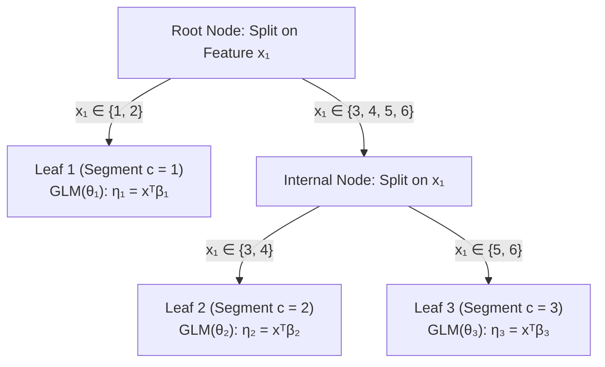
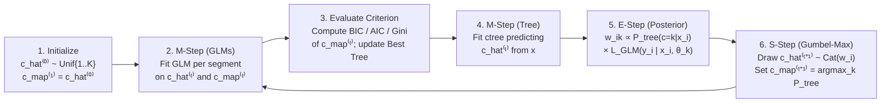

# Mathematical Foundations of `glmtree` (GLM Trees via Stochastic EM)

This document explains the mathematical formulation and algorithmic mechanics of the R package [`glmtree`](../src/probabilistic_modeling/models/r_glmtree/R/glmtree.R) (by Adrien Ehrhardt), and shows how to generalize its leaf models from binary logistic regression to the **Zero-Hurdle GLMs** (`hurdle_poisson` and `hurdle_nbinom`) in [`src/probabilistic_modeling/models/forecasters.py`](../src/probabilistic_modeling/models/forecasters.py).

---

## Contents

1. [High-Level Intuition: What is a GLM Tree?](#1-high-level-intuition-what-is-a-glm-tree)
2. [Two Competing Paradigms: Greedy MOB vs. Latent-Variable SEM](#2-two-competing-paradigms-greedy-mob-vs-latent-variable-sem)
3. [Probabilistic Generative Model of `glmtree`](#3-probabilistic-generative-model-of-glmtree)
4. [Why Stochastic EM (SEM) Instead of Standard EM?](#4-why-stochastic-em-sem-instead-of-standard-em)
5. [Step-by-Step Mathematical Walkthrough of the Algorithm](#5-step-by-step-mathematical-walkthrough-of-the-algorithm)
   - [5.1 Initialization](#51-initialization)
   - [5.2 M-Step Part 1: Fitting Segment GLMs](#52-m-step-part-1-fitting-segment-glms)
   - [5.3 Model Selection Criteria (BIC, AIC, Normalized Gini)](#53-model-selection-criteria-bic-aic-normalized-gini)
   - [5.4 M-Step Part 2: Fitting the Gating Tree (`ctree`)](#54-m-step-part-2-fitting-the-gating-tree-ctree)
   - [5.5 E-Step & S-Step: Posterior Weights & Gumbel-Max Sampling](#55-e-step--s-step-posterior-weights--gumbel-max-sampling)
   - [5.6 Prediction and Edge-Case Fallbacks](#56-prediction-and-edge-case-fallbacks)
6. [Extending `glmtree` to Zero-Hurdle GLMs](#6-extending-glmtree-to-zero-hurdle-glms)
7. [Performance Considerations for a High-Speed Python Implementation](#7-performance-considerations-for-a-high-speed-python-implementation)

---

## 1. High-Level Intuition: What is a GLM Tree?

Standard decision trees (like CART) partition the feature space $\mathcal{X}$ into $K$ disjoint regions (leaves) $\mathcal{R}_1, \dots, \mathcal{R}_K$ and fit a **constant** prediction $\hat{\mu}_k$ inside each leaf. Conversely, a Generalized Linear Model (GLM) fits a single global smooth linear predictor $\eta(\mathbf{x}) = \beta_0 + \mathbf{x}^\top \boldsymbol{\beta}$ across the entire dataset, failing to capture regime switches or complex non-linear interactions unless manually engineered.

A **GLM Tree** combines both:
- **Hard interpretable segmentation (the Tree):** The tree splits the population into $K$ homogeneous segments based on feature rules.
- **Parametric local models (the Leaves):** Inside each leaf $k \in \{1, \dots, K\}$, a full GLM with its own parameter vector $\boldsymbol{\theta}_k$ models the conditional distribution $P(Y \mid \mathbf{x}, C = k; \boldsymbol{\theta}_k)$.



In `generateData(scenario = "tree")` ([`R/generateData.R`](../src/probabilistic_modeling/models/r_glmtree/R/generateData.R)), for example, the slopes on continuous covariates $(x_2, x_3)$ flip signs depending on which pair of levels categorical feature $x_1$ takes:

$$
\boldsymbol{\beta}_1 = (0, -1, 0.5)^\top, \quad
\boldsymbol{\beta}_2 = (0, -0.5, 1.5)^\top, \quad
\boldsymbol{\beta}_3 = (0, 1, -0.5)^\top
$$

A single global GLM averages out these opposing effects and performs poorly, whereas a GLM tree isolates the three regimes and fits an accurate linear predictor in each leaf.

---

## 2. Two Competing Paradigms: Greedy MOB vs. Latent-Variable SEM

In the R ecosystem, there are actually two functions named `glmtree`:

| Aspect | `partykit::glmtree` (MOB — Zeileis et al., 2008) | `glmtree::glmtree` (Ehrhardt, 2019 — **this library**) |
| :--- | :--- | :--- |
| **Core Paradigm** | Top-down greedy recursive partitioning | Latent-variable Mixture of Experts trained via **Stochastic EM (SEM)** |
| **How Splits are Found** | Fits one GLM at the current node, then runs M-fluctuation (score/gradient instability) statistical tests across splitting variables | Treats segment assignment $C_i \in \{1, \dots, K\}$ as an unobserved latent variable; alternates between fitting GLMs per segment, fitting a multi-class tree to predict $C_i$ from $\mathbf{x}_i$, and resampling $C_i$ from its posterior |
| **Horizon / Lookahead** | Myopic (greedy one-split-at-a-time). If a pure interaction requires two splits before the GLM improves, a greedy test at the root may fail to split | Global across up to $K$ segments simultaneously; can discover multi-way segmentations that only make sense jointly |
| **Optimization Nature** | Deterministic top-down pass + pruning | Stochastic Markov chain of length $T$ (`iterations`), keeping the best tree after `burn_in` |

The R code in `src/probabilistic_modeling/models/r_glmtree` implements the second approach: **Stochastic Expectation-Maximization (SEM)**.

---

## 3. Probabilistic Generative Model of `glmtree`

Let our training dataset consist of $n$ observations $\{(\mathbf{x}_i, y_i)\}_{i=1}^n$, where:
- $\mathbf{x}_i \in \mathcal{X}$ is the raw feature vector (used by the tree for splitting) and $\mathbf{X}_i \in \mathbb{R}^p$ is its corresponding design-matrix row (with intercept and one-hot / treatment-coded factors, used by the leaf GLMs).
- $y_i$ is the response variable (in the R package, $y_i \in \{0, 1\}$; in our hurdle extension, $y_i \in \{0, 1, 2, \dots\}$).

We posit an unobserved **latent segment variable** $C_i \in \{1, \dots, K\}$ for each observation $i$. The joint conditional distribution of $(Y_i, C_i)$ given $\mathbf{x}_i$ factors as a **Hierarchical Mixture of Experts**:

$$
P(Y_i = y_i, C_i = k \mid \mathbf{x}_i; \mathcal{T}, \boldsymbol{\Theta})
= \underbrace{P(C_i = k \mid \mathbf{x}_i; \mathcal{T})}_{\text{Gating Network (Decision Tree)}}
\cdot
\underbrace{P(Y_i = y_i \mid \mathbf{X}_i, C_i = k; \boldsymbol{\theta}_k)}_{\text{Expert Model (Leaf GLM } k\text{)}}
$$

Marginalizing over the latent segment $C_i$ gives the marginal likelihood of observation $i$:

$$
P(Y_i = y_i \mid \mathbf{x}_i; \mathcal{T}, \boldsymbol{\Theta})
= \sum_{k=1}^K P(C_i = k \mid \mathbf{x}_i; \mathcal{T}) \, P(Y_i = y_i \mid \mathbf{X}_i, C_i = k; \boldsymbol{\theta}_k)
$$

However, at inference/evaluation time, we want a **hard decision tree** where each observation belongs to a single deterministic leaf segment $c_{\text{MAP}}(\mathbf{x}_i)$:

$$
c_{\text{MAP}}(\mathbf{x}_i) = \arg\max_{k \in \{1, \dots, K\}} P(C_i = k \mid \mathbf{x}_i; \mathcal{T})
$$

Thus, the complete-data log-likelihood for a hard segmentation $\mathbf{c} = (c_1, \dots, c_n) \in \{1, \dots, K\}^n$ is:

$$
\ell_{\text{complete}}(\mathcal{T}, \boldsymbol{\Theta}; \mathbf{y}, \mathbf{X}, \mathbf{c})
= \sum_{i=1}^n \ln P(C_i = c_i \mid \mathbf{x}_i; \mathcal{T})
+ \sum_{k=1}^K \sum_{i : c_i = k} \ln P(Y_i = y_i \mid \mathbf{X}_i; \boldsymbol{\theta}_k)
$$

Notice the crucial decoupling property of $\ell_{\text{complete}}$:
1. **Given the segment labels $\mathbf{c}$**, the leaf GLMs $\boldsymbol{\theta}_1, \dots, \boldsymbol{\theta}_K$ depend *only* on the second term and can be fitted completely independently on each subset $\{i : c_i = k\}$.
2. **Given the segment labels $\mathbf{c}$**, the decision tree $\mathcal{T}$ depends *only* on the first term and is simply a standard multi-class classification tree trained to predict the categorical target $c_i$ from features $\mathbf{x}_i$.

---

## 4. Why Stochastic EM (SEM) Instead of Standard EM?

In standard Expectation-Maximization (EM) for finite mixtures:
- **E-step:** Compute soft posterior responsibilities $\gamma_{ik} = P(C_i = k \mid \mathbf{x}_i, y_i) \in [0, 1]$.
- **M-step:** Fit $K$ weighted GLMs using weights $\gamma_{i1}, \dots, \gamma_{iK}$ across *all* $n$ observations, and fit a gating model to the continuous vector $(\gamma_{i1}, \dots, \gamma_{iK})$.

Standard EM fails or struggles for GLM trees for three reasons:
1. **Standard classification trees expect discrete class labels:** Decision tree algorithms (like `partykit::ctree` or `sklearn`/CART classifiers) partition observations carrying a discrete categorical label $c_i \in \{1, \dots, K\}$ rather than a $K$-dimensional soft responsibility vector per row.
2. **Computational cost ($O(K \cdot n)$ vs. $O(n)$ per M-step):** In soft EM, every GLM must be fitted on all $n$ rows with fractional weights. With hard assignments $c_i$, observation $i$ belongs to only one segment $k$, so $\sum_{k=1}^K n_k = n$.
3. **Escaping local optima & saddle points:** The space of discrete tree topologies is non-convex and combinatorial. Deterministic EM gets trapped immediately in the nearest local maximum (often governed by random initialization).

**Stochastic EM (SEM)** (Celeux & Diebolt, 1985) inserts a **Stochastic step (S-step)** after the E-step:
- Instead of passing soft weights $\gamma_{ik}$ to the M-step, SEM **draws a single hard label** $\hat{c}_i^{(t)} \sim \text{Categorical}(\gamma_{i1}^{(t)}, \dots, \gamma_{iK}^{(t)})$ for each observation $i$.
- As $t = 1, 2, \dots, T$, the sequence $\{(\mathcal{T}^{(t)}, \boldsymbol{\Theta}^{(t)}, \hat{\mathbf{c}}^{(t)})\}$ forms an ergodic Markov chain that explores the posterior landscape of tree structures and naturally merges redundant segments (when a segment is rarely sampled or collapsed by the tree, it vanishes).

---

## 5. Step-by-Step Mathematical Walkthrough of the Algorithm

Below is the exact mathematical correspondence to [`R/glmtree.R`](../src/probabilistic_modeling/models/r_glmtree/R/glmtree.R) and [`R/helpers.R`](../src/probabilistic_modeling/models/r_glmtree/R/helpers.R).



### 5.1 Initialization

Before the loop starts ([`R/glmtree.R` lines 97–118](../src/probabilistic_modeling/models/r_glmtree/R/glmtree.R#L97-L118)):
1. **Design Matrix Construction (`design_matrix`):**
   Build a single numeric matrix $\mathbf{X} \in \mathbb{R}^{n \times p}$ once:
   - Column 1 is the intercept $\mathbf{1}_n$.
   - Continuous columns are kept as-is.
   - Categorical (factor) columns with $L \ge 2$ levels are expanded into $L - 1$ binary indicator columns (treatment coding, omitting the first reference level).
2. **Global Fallback GLM (`global`):**
   Fit a single logistic regression on the entire training set $(\mathbf{X}, \mathbf{y})$ to obtain $\boldsymbol{\beta}_{\text{global}} \in \mathbb{R}^p$. This is used as a fallback if a validation/test observation ever lands in a segment without a fitted leaf GLM.
3. **Random Segment Initialization (`initialization`):**
   For a user-chosen maximum number of segments $K$ (e.g., $K = 10$), draw initial random assignments independently and uniformly:

   $$
   \hat{c}_i^{(1)} \stackrel{\text{i.i.d.}}{\sim} \text{Uniform}\{1, 2, \dots, K\}, \quad i = 1, \dots, n
   $$

   Set $c_{\text{MAP}, i}^{(1)} = \hat{c}_i^{(1)}$.

---

### 5.2 M-Step Part 1: Fitting Segment GLMs

At the start of iteration $t \in \{1, \dots, T\}$ ([`R/glmtree.R` lines 122–133](../src/probabilistic_modeling/models/r_glmtree/R/glmtree.R#L122-L133)):

Notice that the code maintains **two** segmentations at iteration $t$:
- $\hat{\mathbf{c}}^{(t)}$ (`c_hat`): the **stochastically sampled** segment labels from the previous iteration's S-step.
- $\mathbf{c}_{\text{MAP}}^{(t)}$ (`c_map`): the **deterministic tree predictions** from the previous iteration's decision tree $\mathcal{T}^{(t-1)}$, i.e., $c_{\text{MAP}, i}^{(t)} = \arg\max_k P(C_i = k \mid \mathbf{x}_i; \mathcal{T}^{(t-1)})$.

Why both?
- $\hat{\mathbf{c}}^{(t)}$ drives the **Markov chain exploration** (fitting the GLMs used in the likelihood weight calculation and training the next tree $\mathcal{T}^{(t)}$).
- $\mathbf{c}_{\text{MAP}}^{(t)}$ evaluates how good the **actual deployable tree** $\mathcal{T}^{(t-1)}$ is when used deterministically at test time!

For each active label $k \in \mathcal{L}_{\text{hat}}^{(t)} = \text{unique}(\hat{\mathbf{c}}^{(t)})$, let $\mathcal{I}_k = \{i : \hat{c}_i^{(t)} = k\}$ with size $n_k = |\mathcal{I}_k|$. Inside `fit_logit` ([`R/helpers.R` lines 110–115](../src/probabilistic_modeling/models/r_glmtree/R/helpers.R#L110-L115)), a binary logistic regression is fitted by Maximum Likelihood (Iteratively Reweighted Least Squares / `glm.fit`):

$$
\hat{\boldsymbol{\beta}}_k^{(t)} = \arg\max_{\boldsymbol{\beta} \in \mathbb{R}^p} \sum_{i \in \mathcal{I}_k} \Big[ y_i \ln \sigma(\mathbf{X}_i^\top \boldsymbol{\beta}) + (1 - y_i) \ln\big(1 - \sigma(\mathbf{X}_i^\top \boldsymbol{\beta})\big) \Big]
$$

where $\sigma(\eta) = \frac{1}{1 + e^{-\eta}}$ is the logistic link (`stats::plogis`).
- **Rank Deficiency Handling:** Inside a tree leaf, some categorical dummy columns may become constant (e.g., if the tree split on $x_1 \in \{1, 2\}$, then indicators for $x_1 = 3, 4, 5, 6$ are identically $0$ in that leaf!). `glm.fit` detects rank-deficient columns via QR decomposition, sets their coefficients to `NA`, and records the effective numerical rank $r_k = \text{rank}(\mathbf{X}_{\mathcal{I}_k}) \le p$. `fit_logit` replaces those `NA` coefficients with $0$ so matrix multiplication $\mathbf{X} \mathbf{B}$ works seamlessly, while preserving $r_k$ as the true parameter count for AIC/BIC penalties.

The exact same fitting procedure (`fit_segments`) is run on $\mathbf{c}_{\text{MAP}}^{(t)}$ to obtain the deterministic tree leaf coefficients $\hat{\boldsymbol{\beta}}_{\text{MAP}, k}^{(t)}$ and ranks $r_{\text{MAP}, k}^{(t)}$.

---

### 5.3 Model Selection Criteria (BIC, AIC, Normalized Gini)

Next ([`R/glmtree.R` lines 134–154](../src/probabilistic_modeling/models/r_glmtree/R/glmtree.R#L134-L154) and [`R/helpers.R` lines 166–184](../src/probabilistic_modeling/models/r_glmtree/R/helpers.R#L166-L184)), the algorithm evaluates the quality of the deterministic segmentation $\mathbf{c}_{\text{MAP}}^{(t)}$ produced by $\mathcal{T}^{(t-1)}$.

For every observation $i$ with segment $k(i) = c_{\text{MAP}, i}^{(t)}$, its predicted probability is:

$$
\hat{p}_i = \sigma\!\left(\mathbf{X}_i^\top \hat{\boldsymbol{\beta}}_{\text{MAP}, k(i)}^{(t)}\right)
$$

(clamped to $[10^{-12}, 1 - 10^{-12}]$ inside `bernoulli_loglik` to prevent $\ln(0)$).

The segment-level log-likelihood for leaf $k$ is:

$$
\ell_k = \sum_{i : c_{\text{MAP}, i} = k} \Big[ y_i \ln \hat{p}_i + (1 - y_i) \ln(1 - \hat{p}_i) \Big]
$$

Depending on the settings (`validation` and `criterion`), the scalar score $S^{(t)}$ (where **higher is better**) is computed as follows:

1. **Training Set BIC (`criterion = "bic"`, `validation = FALSE` — Default):**
   Each segment $k$ is penalized by its effective rank $r_k$ times the logarithm of **that segment's sample size** $n_k$:

   $$
   \text{BIC}_k = -2 \ell_k + r_k \ln(n_k), \qquad
   S_{\text{BIC}}^{(t)} = -\sum_{k \in \mathcal{L}_{\text{MAP}}^{(t)}} \text{BIC}_k = \sum_{k \in \mathcal{L}_{\text{MAP}}^{(t)}} \big( 2 \ell_k - r_k \ln(n_k) \big)
   $$

2. **Training Set AIC (`criterion = "aic"`, `validation = FALSE`):**

   $$
   \text{AIC}_k = -2 \ell_k + 2 r_k, \qquad
   S_{\text{AIC}}^{(t)} = -\sum_{k \in \mathcal{L}_{\text{MAP}}^{(t)}} \text{AIC}_k = \sum_{k \in \mathcal{L}_{\text{MAP}}^{(t)}} \big( 2 \ell_k - 2 r_k \big)
   $$

3. **Validation Set Log-Likelihood (`criterion %in% c("aic", "bic")`, `validation = TRUE`):**
   When evaluated on a held-out validation set $\mathcal{D}_{\text{val}}$, overfitting is already penalized by out-of-sample evaluation, so the complexity penalty is dropped:

   $$
   S_{\text{val-LL}}^{(t)} = \sum_{i \in \mathcal{D}_{\text{val}}} \Big[ y_i \ln \hat{p}_i + (1 - y_i) \ln(1 - \hat{p}_i) \Big]
   $$

4. **Normalized Gini Index (`criterion = "gini"`):**
   Defined in [`R/normalizedGini.R`](../src/probabilistic_modeling/models/r_glmtree/R/normalizedGini.R) via the Wilcoxon-Mann-Whitney rank formula:

   $$
   \text{Gini}(\mathbf{y}, \hat{\mathbf{p}}) = 2 \cdot \text{AUC}(\mathbf{y}, \hat{\mathbf{p}}) - 1
   = 2 \left( \frac{\sum_{i : y_i = 1} \text{rank}(\hat{p}_i) - \frac{n_+ (n_+ + 1)}{2}}{n_+ \, n_-} \right) - 1 \in [-1, 1]
   $$

   where $n_+ = \sum_i y_i$ and $n_- = n - n_+$.

**Tracking the Best Tree & Early Stopping:**
- Because the first few iterations depend heavily on the random uniform initialization, iterations $t \le t_{\text{burn\_in}}$ (along with $t = 1$, where no tree $\mathcal{T}$ exists yet) are excluded from selection.
- For $t > \max(1, t_{\text{burn\_in}})$, if $S^{(t)} > S_{\text{best}}$, we update $\text{best} \leftarrow (\mathcal{T}^{(t-1)}, \mathbf{c}_{\text{MAP}}^{(t)}, S^{(t)})$.
- If `patience` is set and $t - t_{\text{best}} \ge \text{patience}$, the loop terminates early.

---

### 5.4 M-Step Part 2: Fitting the Gating Tree (`ctree`)

Next ([`R/glmtree.R` lines 157–163](../src/probabilistic_modeling/models/r_glmtree/R/glmtree.R#L157-L163)):
If $|\mathcal{L}_{\text{hat}}^{(t)}| < 2$ (all observations collapsed into a single segment), the chain stops early. Otherwise, we fit a classification tree $\mathcal{T}^{(t)}$ to predict the categorical label $\text{factor}(\hat{c}_i^{(t)})$ from the raw features $\mathbf{x}_i$:

```r
data_tree <- data.frame(.segment = factor(c_hat), x_train)
link <- partykit::ctree(.segment ~ ., data = data_tree, control = ctree_controls)
```

**Why does `glmtree` use `partykit::ctree` (Conditional Inference Trees, Hothorn et al., 2006)?**
- Standard CART trees evaluate every possible cutpoint across every feature and pick the one that maximizes information gain / Gini impurity reduction. This has a well-known **selection bias toward continuous features and categorical features with many levels** (because they offer more candidate split points).
- `ctree` separates **variable selection** from **split point selection**:
  1. For each feature $X_j$, it tests the global null hypothesis of independence $H_0^j : P(\hat{C} \mid X_j) = P(\hat{C})$ using a permutation-based linear association test statistic (a $\chi^2$ or normal score test).
  2. It selects the feature $X_{j^*}$ with the **smallest $p$-value**, and only splits if the multiplicity-adjusted $p$-value is below `alpha` (e.g., $\alpha = 0.1$).
  3. Only after selecting $X_{j^*}$ does it find the optimal binary split on $X_{j^*}$ (respecting `minbucket` and `maxdepth`).
- This ensures that when there is **no true tree structure** (`scenario = "no tree"`), `ctree` fails to reject $H_0$ or quickly collapses the segments into a single root node rather than hallucinating spurious splits!

From the fitted tree $\mathcal{T}^{(t)}$, for each observation $i$ falling into terminal leaf $\tau(\mathbf{x}_i)$, the tree outputs the empirical class distribution of $\hat{\mathbf{c}}^{(t)}$ in that leaf:

$$
\pi_{ik}^{(t)} = \hat{P}\!\left(C_i = k \mid \mathbf{x}_i; \mathcal{T}^{(t)}\right)
= \frac{\sum_{j \in \tau(\mathbf{x}_i)} \mathbb{I}\!\left(\hat{c}_j^{(t)} = k\right)}{|\tau(\mathbf{x}_i)|}, \qquad k \in \mathcal{L}_{\text{hat}}^{(t)}
$$

And the new deterministic MAP segmentation for iteration $t+1$ is:

$$
c_{\text{MAP}, i}^{(t+1)} = \arg\max_{k \in \mathcal{L}_{\text{hat}}^{(t)}} \pi_{ik}^{(t)}
$$

---

### 5.5 E-Step & S-Step: Posterior Weights & Gumbel-Max Sampling

Now comes the core Bayesian update + Stochastic step ([`R/glmtree.R` lines 164–167](../src/probabilistic_modeling/models/r_glmtree/R/glmtree.R#L164-L167) and `draw_segments` in [`R/helpers.R` lines 192–195](../src/probabilistic_modeling/models/r_glmtree/R/helpers.R#L192-L195)):

1. **Evaluate Every Observation Under Every Segment's GLM (`p_hat` & `likelihood`):**
   We compute the $n \times |\mathcal{L}_{\text{hat}}^{(t)}|$ matrix of predicted probabilities:

   $$
   \hat{p}_{ik}^{(t)} = \sigma\!\left(\mathbf{X}_i^\top \hat{\boldsymbol{\beta}}_k^{(t)}\right), \qquad i = 1, \dots, n, \quad k \in \mathcal{L}_{\text{hat}}^{(t)}
   $$

   and the corresponding Bernoulli likelihood matrix $\mathbf{L} \in \mathbb{R}^{n \times |\mathcal{L}_{\text{hat}}^{(t)}|}$:

   $$
   L_{ik}^{(t)} = P\!\left(Y_i = y_i \mid \mathbf{X}_i, C_i = k; \hat{\boldsymbol{\beta}}_k^{(t)}\right)
   = y_i \hat{p}_{ik}^{(t)} + (1 - y_i)\!\left(1 - \hat{p}_{ik}^{(t)}\right)
   $$

2. **Compute Unnormalized Posterior Responsibilities (`weights` — The E-step):**
   By Bayes' rule, the posterior probability that observation $i$ belongs to segment $k$ given both $\mathbf{x}_i$ and $y_i$ is proportional to the prior (tree probability $\pi_{ik}^{(t)}$) times the likelihood ($L_{ik}^{(t)}$, floored at $10^{-12}$):

   $$
   w_{ik}^{(t)} = \pi_{ik}^{(t)} \cdot \max\!\left(L_{ik}^{(t)}, \, 10^{-12}\right),
   \qquad
   \gamma_{ik}^{(t)} = P(C_i = k \mid \mathbf{x}_i, y_i) = \frac{w_{ik}^{(t)}}{\sum_{m \in \mathcal{L}_{\text{hat}}^{(t)}} w_{im}^{(t)}}
   $$

   **Intuition of $w_{ik}^{(t)}$:**
   - If the tree says segment $k$ is impossible in observation $i$'s leaf ($\pi_{ik}^{(t)} = 0$), then $w_{ik}^{(t)} = 0$, so observation $i$ cannot be assigned to segment $k$. This forces the latent segments $\hat{\mathbf{c}}$ to become progressively more aligned with axis-aligned tree splits!
   - Among the segments that have non-zero presence in leaf $\tau(\mathbf{x}_i)$, observation $i$ is pulled toward the segment $k$ whose GLM $\hat{\boldsymbol{\beta}}_k^{(t)}$ best explains its observed outcome $y_i$ (high $L_{ik}^{(t)}$).

3. **Vectorized Categorical Sampling via the Gumbel-Max Trick (`draw_segments` — The S-step):**
   We want to sample $\hat{c}_i^{(t+1)} \sim \text{Categorical}(\gamma_{i1}^{(t)}, \dots, \gamma_{iK}^{(t)})$ independently for all $i = 1, \dots, n$ without writing a slow row-by-row loop or normalizing rows.
   `draw_segments` uses the **Gumbel-Max Trick**:
   - If $U_{ik} \stackrel{\text{i.i.d.}}{\sim} \text{Uniform}(0, 1)$, then $G_{ik} = -\ln(-\ln U_{ik}) \stackrel{\text{i.i.d.}}{\sim} \text{Gumbel}(0, 1)$.
   - A foundational property of the Gumbel distribution is that adding independent standard Gumbel noise to log-unnormalized weights and taking the $\arg\max$ produces an **exact sample** from the normalized categorical distribution:

   $$
   \hat{c}_i^{(t+1)} = \arg\max_{k \in \mathcal{L}_{\text{hat}}^{(t)}} \Big\{ \ln w_{ik}^{(t)} - \ln\!\big(-\ln U_{ik}^{(t)}\big) \Big\}
   $$

   Proof sketch: Let $Z_k = \ln w_k + G_k$ where $P(G_k \le g) = \exp(-e^{-g})$. Then:

   $$
   P(Z_k > Z_m \;\forall m \ne k)
   = \int_{-\infty}^\infty f_{G_k}(z - \ln w_k) \prod_{m \ne k} F_{G_m}(z - \ln w_m) \, dz
   = \frac{w_k}{\sum_m w_m} = \gamma_k
   $$

   Note: When $\pi_{ik}^{(t)} = 0$, $\ln w_{ik}^{(t)} = -\infty$, so segment $k$ is never selected. And if a segment $k$ receives zero observations across all $i$, it permanently drops out of $\mathcal{L}_{\text{hat}}$, which is how the algorithm automatically reduces the number of segments from $K$ down to the optimal number of leaves $(\le K)$!

---

### 5.6 Prediction and Edge-Case Fallbacks

Once the loop finishes, `glmtree` extracts the best iteration's tree $\mathcal{T}^*$ and fits the final segment GLMs on $\mathbf{c}_{\text{MAP}}^*$.

When predicting on new data $\mathbf{x}_{\text{new}}$ (`predict_core` in [`R/helpers.R` lines 202–214](../src/probabilistic_modeling/models/r_glmtree/R/helpers.R#L202-L214)):
1. **Route through the tree:** Find the predicted segment $k^* = \arg\max_k P(C = k \mid \mathbf{x}_{\text{new}}; \mathcal{T}^*)$.
2. **Apply segment GLM:** Compute $\hat{p} = \sigma(\mathbf{X}_{\text{new}}^\top \hat{\boldsymbol{\beta}}_{k^*}^*)$.
3. **Fallback 1 (Missing segment GLM):** If segment $k^*$ somehow had no fitted GLM, use the global GLM coefficients $\hat{p} = \sigma(\mathbf{X}_{\text{new}}^\top \boldsymbol{\beta}_{\text{global}})$.
4. **Fallback 2 (Unseen categorical factor level at test time):** If $\mathbf{x}_{\text{new}}$ contains a factor level that never appeared in training, `align_features` sets that factor to `NA` (so the tree can still route it via surrogate/default splits) and replaces the GLM prediction with the empirical mean response rate $\bar{y}_{k^*}$ of segment $k^*$ (or the global mean $\bar{y}$).

---

## 6. Extending `glmtree` to Zero-Hurdle GLMs

In [`src/probabilistic_modeling/models/forecasters.py`](../src/probabilistic_modeling/models/forecasters.py), our demand forecasting models use a **Two-Part Zero-Hurdle GLM** (`hurdle_poisson` or `hurdle_nbinom`) for count targets $y_i \in \{0, 1, 2, \dots\}$.

Because the SEM framework of `glmtree` interacts with the leaf model **strictly through its log-likelihood and degrees of freedom**, replacing the binary logistic regression leaves with our Zero-Hurdle GLM is mathematically clean and modular!

### 6.1 Leaf Likelihood of the Zero-Hurdle GLM

In leaf segment $k$, the parameter vector is $\boldsymbol{\theta}_k = (\boldsymbol{\beta}_{k,\text{bin}}, \, \boldsymbol{\beta}_{k,\text{count}}, \, \alpha_k)$, comprising:
1. **Binary Hurdle Stage (`_fit_hurdle_binary_stage`):** Models whether demand is positive, $P(Y_i > 0 \mid \mathbf{X}_i, C_i = k)$, via logistic regression:

   $$
   \pi_{ik}^{\text{pos}} = P(Y_i > 0 \mid \mathbf{X}_i; \boldsymbol{\beta}_{k,\text{bin}}) = \sigma\!\left(\mathbf{X}_i^\top \boldsymbol{\beta}_{k,\text{bin}}\right)
   $$

2. **Zero-Truncated Count Stage (`_fit_hurdle_count_stage`):** Models positive demand $P(Y_i = y_i \mid Y_i > 0, \mathbf{X}_i, C_i = k)$ for $y_i \ge 1$ using an untruncated rate $\lambda_{ik} = \exp(\mathbf{X}_i^\top \boldsymbol{\beta}_{k,\text{count}})$:
   - **Zero-Truncated Poisson (ZTP):** Let $P_0(\lambda_{ik}) = \exp(-\lambda_{ik})$. For $y_i \ge 1$:

     $$
     \ln P_{\text{ZTP}}(Y_i = y_i \mid \lambda_{ik})
     = y_i \ln \lambda_{ik} - \lambda_{ik} - \ln\Gamma(y_i + 1) - \ln\!\big(1 - e^{-\lambda_{ik}}\big)
     $$

   - **Zero-Truncated Negative Binomial NB2 (ZTNB2):** With dispersion $\alpha_k > 0$ and $r_k^{\text{disp}} = \alpha_k^{-1}$, let $P_0(\lambda_{ik}, \alpha_k) = (1 + \alpha_k \lambda_{ik})^{-1/\alpha_k}$. For $y_i \ge 1$:

     $$
     \ln P_{\text{ZTNB2}}(Y_i = y_i \mid \lambda_{ik}, \alpha_k)
     = \ln\Gamma(y_i + r_k^{\text{disp}}) - \ln\Gamma(r_k^{\text{disp}}) - \ln\Gamma(y_i + 1)
     + r_k^{\text{disp}} \ln r_k^{\text{disp}} + y_i \ln \lambda_{ik}
     - (y_i + r_k^{\text{disp}}) \ln(r_k^{\text{disp}} + \lambda_{ik})
     - \ln\!\big(1 - P_0(\lambda_{ik}, \alpha_k)\big)
     $$

Combining the two stages gives the exact **Hurdle log-likelihood** $\ell_{ik}^{\text{hurdle}} = \ln P(Y_i = y_i \mid \mathbf{X}_i, C_i = k; \boldsymbol{\theta}_k)$:

$$
\ell_{ik}^{\text{hurdle}}(y_i) =
\begin{cases}
\ln\!\left(1 - \pi_{ik}^{\text{pos}}\right) & \text{if } y_i = 0, \\[8pt]
\ln\!\left(\pi_{ik}^{\text{pos}}\right) + \ln P_{\text{ZT}}\!\left(Y_i = y_i \mid \lambda_{ik}, \alpha_k\right) & \text{if } y_i \ge 1.
\end{cases}
$$

Notice a great structural property of the Hurdle log-likelihood:
- Within each segment $k$, the binary log-likelihood $\sum_{i \in \mathcal{I}_k} \big[ \mathbb{I}(y_i > 0) \ln \pi_{ik}^{\text{pos}} + \mathbb{I}(y_i = 0) \ln(1 - \pi_{ik}^{\text{pos}}) \big]$ and the zero-truncated count log-likelihood $\sum_{i \in \mathcal{I}_k, y_i > 0} \ln P_{\text{ZT}}(y_i \mid \lambda_{ik}, \alpha_k)$ **still decouple completely** during the M-step!
- However, during the **E/S-step**, **both** parts jointly determine the segment reassignment weight $w_{ik}^{(t)}$! Specifically:
  - When $y_i = 0$, observation $i$ prefers segments whose binary hurdle predicts a high zero probability $(1 - \pi_{ik}^{\text{pos}})$.
  - When $y_i \ge 1$, observation $i$ prefers segments where *both* the positive probability $\pi_{ik}^{\text{pos}}$ *and* the zero-truncated count probability $P_{\text{ZT}}(y_i \mid \lambda_{ik}, \alpha_k)$ assign high likelihood to $y_i$.

### 6.2 Numerical Stability in the S-Step (Working in Log-Space)

In the R `glmtree` package, the code computes `likelihood <- y * p + (1 - y) * (1 - p)` in probability space and then takes `log(weights)` inside `draw_segments`. For count and hurdle models, $P(Y_i = y_i \mid \dots)$ for large counts can be $< 10^{-15}$, so exponentiating and then taking $\ln$ loses precision.

Instead, in our Hurdle `glmtree`, we should work **entirely in log-space** during the E/S-step:

$$
\ln w_{ik}^{(t)} = \ln \pi_{ik}^{(t)} + \max\!\left(\ell_{ik}^{\text{hurdle}}(y_i), \, \ln(10^{-12})\right)
$$

and pass $\ln w_{ik}^{(t)}$ directly into the Gumbel-Max sampler:

$$
\hat{c}_i^{(t+1)} = \arg\max_{k \in \mathcal{L}_{\text{hat}}^{(t)}} \Big\{ \ln \pi_{ik}^{(t)} + \ell_{ik}^{\text{hurdle}}(y_i) - \ln\!\big(-\ln U_{ik}^{(t)}\big) \Big\}
$$

### 6.3 Selection Criteria (BIC / AIC / Holdout Metrics) for Hurdle GLM Trees

In a Hurdle leaf $k$ with $n_k$ total observations and $n_{k,+} = \sum_{i \in \mathcal{I}_k} \mathbb{I}(y_i > 0)$ positive observations:
- Let $r_{k,\text{bin}} = \text{rank}(\mathbf{X}_{\mathcal{I}_k})$ be the number of active parameters in the binary hurdle stage.
- Let $r_{k,\text{count}} = \text{rank}(\mathbf{X}_{\mathcal{I}_{k,+}}) + \mathbb{I}(\text{NB2})$ be the number of active parameters in the zero-truncated count stage (including $+1$ for $\alpha_k$ if NB2 is used).
- The segment BIC penalty accurately reflects that the binary stage is estimated on $n_k$ rows while the count stage is estimated on $n_{k,+}$ rows:

$$
\text{BIC}_k^{\text{hurdle}}
= -2 \sum_{i \in \mathcal{I}_k} \ell_{ik}^{\text{hurdle}}(y_i)
+ r_{k,\text{bin}} \ln(n_k)
+ r_{k,\text{count}} \ln(\max(n_{k,+}, 1))
$$

(or using total segment parameters $(r_{k,\text{bin}} + r_{k,\text{count}}) \ln(n_k)$).
- On a validation set, we can select the best tree using **out-of-sample Hurdle log-likelihood** or **CRPS** (`quantile_crps`).

---

## 7. Performance Considerations for a High-Speed Python Implementation

When we build the high-performance Python version of `GLMTree`, the R implementation reveals several major bottlenecks that we can eliminate:

1. **Eliminating R DataFrame & Formula Overhead Inside the SEM Loop:**
   - In `R/glmtree.R`, every single SEM iteration $t = 1, \dots, 200$ constructs a new `data.frame(.segment = factor(c_hat), x_train)` and calls `partykit::ctree(.segment ~ ., ...)`, followed by $2K$ calls to `stats::glm.fit` on sliced sub-matrices.
   - In Python, we already have Numba-compiled analytical gradients (`_ztp_nll_and_grad_eta`, `_ztnb2_nll_and_grad_eta` in [`forecasters.py`](../src/probabilistic_modeling/models/forecasters.py#L235-L339)) and can add a Numba-compiled Newton-Raphson / IRLS solver for the binary logit stage and warm-start $\hat{\boldsymbol{\beta}}_k^{(t)}$ from $\hat{\boldsymbol{\beta}}_k^{(t-1)}$!
2. **Avoid Duplicate GLM Fits When $c_{\text{MAP}} \ne \hat{c}$:**
   - In `R/glmtree.R` lines 124–133, every iteration fits **two** full sets of $K$ GLMs (`fit_hat` on $\hat{\mathbf{c}}^{(t)}$ and `fit_map` on $\mathbf{c}_{\text{MAP}}^{(t)}$). Warm-starting both from the previous iteration's coefficients reduces IRLS/L-BFGS-B iterations from ~15–50 down to 2–4 per segment.
3. **Fast Multi-Class Tree Gating in Python:**
   - For the gating tree $P(C \mid \mathbf{x})$, we can support either:
     - **Fast Cython/C++ CART (`sklearn.tree.DecisionTreeClassifier`)** with `min_samples_leaf`, `max_depth`, and `ccp_alpha` (orders of magnitude faster than `partykit::ctree` in R), or
     - **Numba-accelerated Conditional Inference (`ctree`)** using fast permutation/$\chi^2$/ANOVA association tests so we preserve `ctree`'s unbiased split selection and automatic stopping under the null hypothesis (`scenario = "no tree"`).
4. **Numba-Compiled E/S-Step Kernel:**
   - Evaluating the $n \times K$ Hurdle log-likelihood matrix $\ell_{ik}^{\text{hurdle}}$ and drawing $\hat{\mathbf{c}}^{(t+1)}$ via the Gumbel-Max trick can be fused into a single `@njit(parallel=True, nogil=True)` kernel with zero intermediate $n \times K$ array allocations.
